# Diagram Authoring Skill for Foliant & Mermaid Sequence Viewer

This skill guides AI agents in authoring, editing, and validating Mermaid sequence and flowchart diagrams with embedded metadata for **Foliant** (Mermaid Sequence Viewer). Foliant renders diagrams with interactive filtering, animated flows, domain tagging, and saved perspectives by reading structured comments and JSON metadata headers.

---

## 1. File Formats Supported

Foliant operates on two file types:
1. **Standalone `.mmd` files**: Pure Mermaid source code. The file MUST start on line 1 with the `%% CONFIG:` header (if metadata is present), followed by `sequenceDiagram` or `flowchart TD`/`flowchart LR`.
2. **Markdown `.md` documents**: Architecture documents containing one or more embedded ````mermaid ... ```` blocks. Each block can optionally begin with `%% CONFIG:` on its very first line.

---

## 2. Metadata Header: `%% CONFIG: { ... }`

The metadata header persists diagram state, styling, animations, filtering keys, and saved views.

### Placement & Syntax Rules
- **Line 1 Requirement**: In `.mmd` files, `%% CONFIG:` MUST be the first non-empty line. In markdown embedded blocks, it MUST be the first line after ````mermaid`.
- **JSON Format**: The prefix `%% CONFIG: ` is followed immediately by a single-line, valid JSON string.
- **Version**: Always set `"version": 1`.

### TypeScript Schema

```ts
interface DiagramConfig {
  version: 1;
  actors?: Record<string, ActorMetadata>;
  arrows?: ArrowStyle[];
  defaultArrowStyle?: ArrowStyleDefaults;
  noteTags?: NoteTagEntry[];
  notes?: StickyNote[];
  views?: SavedView[];
}

interface ActorMetadata {
  color?: string;     // Hex color (e.g. "#213b5e" dark / "#cfe2f3" light)
  keys?: string[];    // Domain tags for filtering (e.g. ["auth", "security"])
}

interface ArrowStyle {
  from: string;                 // Raw participant/node ID in the diagram
  to: string;                   // Raw participant/node ID in the diagram
  label?: string;               // Exact message/edge label
  occurrence?: number;          // 0-based index for duplicate same-endpoint arrows
  color?: string;               // Hex color (e.g. "#00ff9d" emerald, "#ff2a85" rose)
  width?: number;               // Stroke width: 1-10
  dash?: 'solid' | 'dashed' | 'dotted';
  animation?: ArrowAnimationType;
  keys?: string[];              // Tags assigned to this specific arrow
  keyMode?: 'clean' | 'merged'; // 'clean' = arrow tags only; 'merged' = inherits sender tags (default)
}

type ArrowAnimationType =
  | 'none'
  | 'flow'             // Smooth continuous streaming tracer
  | 'pulse'            // Traveling glowing packet
  | 'cyber'            // High-velocity neon tracer
  | 'broken-sender'    // Origin glitch/alarm (HTTP 500 / error)
  | 'broken-network'   // Severed connection gap in transit
  | 'broken-receiver'  // Target rejection shockwave / crash
  | 'stutter'          // Jittery delivery
  | 'ricochet'         // Bounce effect
  | 'hesitate';        // Paused delivery

interface ArrowStyleDefaults {
  color?: string;      // Fallback stroke color for all arrows
  width?: number;      // Fallback stroke width
}

interface NoteTagEntry {
  over: string[];      // Array of participant IDs spanned by the note
  text: string;        // Note text
  occurrence?: number; // 0-based index for duplicate notes
  keys?: string[];     // Filter tags
}

interface StickyNote {
  id: string;          // Unique ID, e.g. "note_1792046768697_67bhu"
  x: number;           // Canvas coordinate X
  y: number;           // Canvas coordinate Y
  text: string;        // Markdown content
  color?: 'yellow' | 'green' | 'blue' | 'pink' | 'orange' | 'purple';
  width?: number;
  height?: number;
  keys?: string[];
}

interface SavedView {
  name: string;        // Human-readable view name (e.g. "Happy Path", "Failure Modes")
  hiddenPaths?: string[]; // Region paths to hide (e.g. ["flow=login/edge-case=timeout"])
}
```

---

## 3. Recommended Color Palettes

### Actor Preset Tones
* **Dark Mode Tones**: `#213b5e` (navy), `#621d26` (burgundy), `#194821` (forest), `#3d1d62` (purple), `#584a1f` (amber), `#1a5557` (teal).
* **Light Mode Tones**: `#cfe2f3` (soft blue), `#f8d0d6` (soft rose), `#cdeed3` (soft green), `#e2d0f8` (soft lavender), `#f5ebc8` (soft yellow), `#c9f0f2` (soft cyan).

### Animated Arrow Colors
* **Happy Path / Success Streams**:
  - Emerald: `#00ff9d`
  - Teal: `#00f0ff`
  - Ocean: `#00bfff`
  - Mint: `#38ef7d`
  - Indigo: `#4f8cff`
* **Failure / Error / Warning Streams**:
  - Rose: `#ff2a85`
  - Flame: `#ff6600`
  - Amber: `#ffbe0b`
  - Crimson: `#ff3366`
  - Ruby: `#ff1744`

---

## 4. Custom Region Syntax: Interactive Filtering

Wrap diagram sections in region comments to allow users to toggle whole flows, edge cases, or notes on/off from the viewer sidebar.

### Syntax
- `%% @region-start: type=value`
- `%% @region-end`

### Standard Region Types
- **Flow**: `%% @region-start: flow=kebab-case-flow-name`
- **Edge Case**: `%% @region-start: edge-case=kebab-case-case-name`
- **Note**: `%% @region-start: note`

### Region Authoring Rules
1. **Always match boundaries**: Every `%% @region-start` must have an exact matching `%% @region-end`.
2. **Proper nesting**: Regions can nest (e.g. an `edge-case` inside a `flow`). Blocks (`rect`, `alt`, `opt`, `loop`) must not straddle region boundaries.
3. **Core vs Flow Participants**: Core participants used across multiple flows belong outside all regions. Participants unique to a specific flow should be declared inside that flow's region so they disappear cleanly when the flow is toggled off.

---

## 5. Structural Grouping Tags (Levels of Abstraction)

Foliant automatically derives filter tags from structural Mermaid groupings:
- **Sequence Diagrams**: `box <Title>` ... `end`
  - Example: `box Payment Service` creates a filter key `payment-service`.
  - In the sidebar **By Key** filter, users can set the key to:
    - **On**: Full view of all internal actors and messages.
    - **Merged**: Collapses the box into a single actor labeled with the box title. Internal messages become self-calls.
    - **Clean**: Collapses the box and drops internal self-calls, showing only boundary messages.
- **Flowcharts**: `subgraph <Title>` or `subgraph <id> [<Title>]` ... `end`

---

## 6. Complete Example: Sequence Diagram with Metadata

```mermaid
%% CONFIG: {"version":1,"actors":{"Client":{"color":"#213b5e","keys":["frontend"]},"Gateway":{"color":"#1a5557","keys":["api"]},"Auth":{"color":"#3d1d62","keys":["security"]},"DB":{"color":"#194821","keys":["storage"]}},"arrows":[{"from":"Client","to":"Gateway","label":"POST /auth/login","color":"#00ff9d","animation":"pulse"},{"from":"Gateway","to":"Auth","label":"Validate Credentials","color":"#00ff9d","animation":"flow"},{"from":"Auth","to":"Gateway","label":"401 Unauthorized","color":"#ff2a85","animation":"broken-receiver"},{"from":"Auth","to":"DB","label":"Query user by email","color":"#00ff9d","animation":"flow"},{"from":"DB","to":"Auth","label":"User record & hash","color":"#00ff9d","animation":"flow"},{"from":"Auth","to":"Gateway","label":"Issue JWT Session","color":"#00ff9d","animation":"flow"},{"from":"Gateway","to":"Client","label":"200 OK (JWT)","color":"#00ff9d","animation":"pulse"}],"views":[{"name":"Happy Path Only","hiddenPaths":["flow=login/edge-case=invalid-credentials"]}]}
sequenceDiagram
    autonumber
    participant Client
    participant Gateway as API Gateway
    box Authentication Domain
        participant Auth as Auth Service
        participant DB as Users Database
    end

    %% @region-start: flow=login
    rect rgb(20, 30, 48)
        Client->>Gateway: POST /auth/login
        Gateway->>Auth: Validate Credentials

        %% @region-start: edge-case=invalid-credentials
        Auth-->>Gateway: 401 Unauthorized
        Gateway-->>Client: 401 Invalid Credentials
        %% @region-end

        Auth->>DB: Query user by email
        DB-->>Auth: User record & hash
        Auth-->>Gateway: Issue JWT Session
        Gateway-->>Client: 200 OK (JWT)
    end
    %% @region-end
```



---

## 7. Authoring Checklist for AI Agents

Before providing or saving any Mermaid diagram:
1. **Header Validation**: Is `%% CONFIG:` formatted as valid, single-line JSON on line 1?
2. **Actor IDs Match**: Do `actors` keys and `arrows[].from`/`to` match the exact raw identifiers used in `participant ID as Label`?
3. **Region Closure**: Does every `%% @region-start:` have a corresponding `%% @region-end`?
4. **No Straddling Blocks**: Are all `rect`, `alt`, `opt`, `loop`, and `box` blocks closed before region ends?
5. **Semantic Colors**: Are happy paths marked with positive colors (`#00ff9d`, `#00f0ff`) and failures marked with error colors (`#ff2a85`, `#ff6600`)?
6. **Autonumber**: In sequence diagrams, add `autonumber` after `sequenceDiagram` for clear numbered steps when appropriate.
