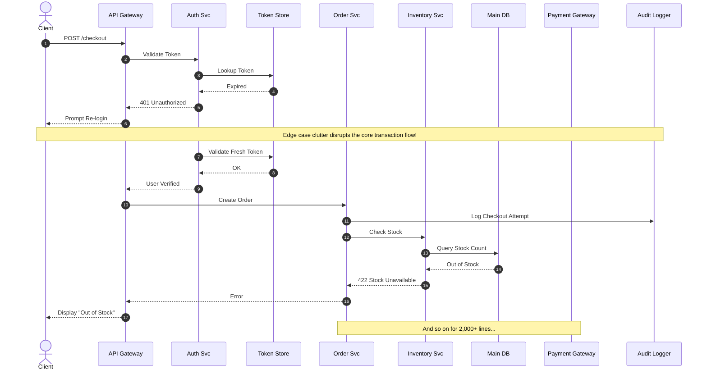
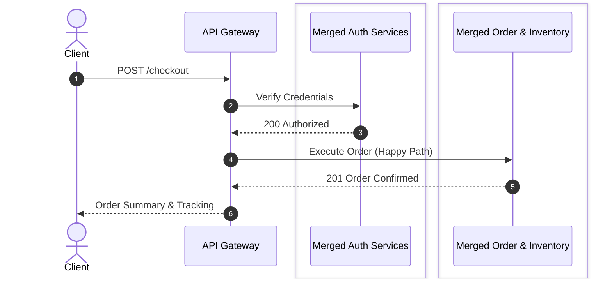
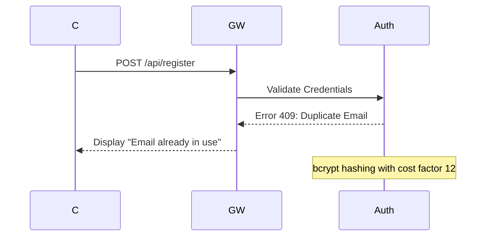

# Mermaid Sequence & Flowchart Viewer

[](./LICENSE)
[](https://nextjs.org/)
[](https://mermaid.js.org/)
[](https://vitest.dev/)
[](https://www.typescriptlang.org/)

> **A local-first, bidirectional WYSIWYG editor and architectural viewer for massive Mermaid diagrams (2,000+ lines, 50+ flows) with hierarchical layers, dynamic domain merging, zero syntax breakage, and interactive delighters.**

---

## Table of Contents

- [The Gap: Why This Project Exists](#-the-gap-why-this-project-exists)
- [Quick Start & Build](#-quick-start--build)
- [Solving The Diagram Maintainability Gap](#-solving-the-diagram-maintainability-gap)
  - [The Problem: Unmaintainable Monoliths](#the-problem-unmaintainable-monolithic-diagrams)
  - [The Solution: Layers & Dynamic Domain Merging](#the-solution-layered-views--dynamic-domain-merging)
- [WYSIWYG Canvas Editing (Valid Mermaid Guarantee)](#-wysiwyg-canvas-editing-valid-mermaid-guarantee)
  - [Direct Canvas Manipulations](#1-direct-canvas-manipulation)
  - [Context-Sensitive Properties Panel](#2-context-sensitive-properties-panel)
  - [Safety & Reliability Safeguards](#3-safety--reliability-safeguards)
- [Supported Diagram Types](#-supported-diagram-types)
  - [Sequence Diagrams](#1-sequence-diagrams-sequencediagram)
  - [Flowcharts](#2-flowcharts-flowchart)
- [Interactive Outliers & Visual Delighters](#-interactive-outliers--visual-delighters)
  - [Draggable Markdown Sticky Notes](#1-draggable-markdown-sticky-notes)
  - [Animated Arrows & Motion Presets](#2-animated-arrows--motion-presets)
  - [Monaco Split-View & Live Line Diffing](#3-monaco-split-view--live-line-diffing)
  - [One-Click Productivity Knobs](#4-one-click-productivity-knobs)
  - [Standalone SVG Export](#5-standalone-svg-export)
- [Authoring Syntax & Configuration Guide](#-authoring-syntax--configuration-guide)
  - [Hierarchical Regions (`%% @region-start`)](#1-hierarchical-regions---region-start)
  - [Configuration Header (`%% CONFIG:`)](#2-configuration-header---config)
  - [LLM Context Guidelines](#3-llm-context-guidelines-diagram-guidelinesmd)
- [Saved Views & URL State Persistence](#-saved-views--url-state-persistence)
- [Architecture & Tech Stack](#-architecture--tech-stack)
- [Testing & Quality Assurance](#-testing--quality-assurance)

---

## 🧭 The Gap: Why This Project Exists

Modern distributed systems and microservice architectures are notoriously difficult to document and maintain. Teams are routinely trapped between two flawed extremes:

| Approach | What Works | The Critical Failure Mode |
|---|---|---|
| **Text-as-Code (Mermaid CLI, PlantUML)** | Version-controlled in Git, diffable in PRs, co-located with code, easy for LLMs to generate. | **Unmaintainable at scale.** Monolithic diagrams turn into 2,000-line walls of text. Tweaking arrow endpoints, reordering execution steps, or renaming actors requires tedious manual regex editing. Visualizing edge cases clutters the happy path. |
| **Visual Canvas Tools (Lucidchart, Miro, Draw.io)** | Intuitive drag-and-drop, quick whiteboard iteration, easy stakeholder presentation. | **Broken Git workflows & developer silos.** Proprietary binaries or opaque XML blobs break git diffs, drift instantly from codebase realities, cannot be read or refactored by LLMs, and introduce vendor lock-in. |
| **Online Web Previews (mermaid.live)** | Instant visual preview of raw syntax. | **Pure read-only/scratchpad.** No direct canvas manipulation, no file-system watching, no domain merging, and no way to isolate flows or edge cases on massive architecture diagrams. |

### The Solution: A Bidirectional Bridge
This project fills the gap between **raw text diagrams** and **visual whiteboard canvas tools**:
1. **Single Source of Truth**: The `.mmd` plain-text file on your local disk remains the single source of truth. Every canvas click, drag, recolor, and retarget directly compiles into **clean, valid, idiomatic Mermaid syntax**.
2. **True WYSIWYG Manipulation**: Click, drag, reorder, connect lifelines, recolor, and retarget arrow endpoints directly on the rendered SVG canvas.
3. **Architectural Maintainability at Enterprise Scale**: Hierarchical layers (`%% @region-start`), dynamic microservice merging (collapsing 10 microservices into a single domain block on the fly), and non-destructive saved views.
4. **Interactive Delighters**: Draggable Markdown sticky notes with live task checklists, 6 animated arrow motion styles, bi-directional Monaco editor split-view with live line-diff highlighting, and standalone SVG export.

---

## 🚀 Quick Start & Build

The viewer runs locally on your machine, watching your local repository's diagrams directory via `chokidar` and Server-Sent Events (SSE).

### Prerequisites
- Node.js 18+ (tested on Node 18, 20, 22)
- npm 9+

### 1. Installation
Clone the repository and install dependencies:
```bash
git clone https://github.com/your-org/mermaid-sequence-viewer.git
cd mermaid-sequence-viewer
npm install
```

### 2. Development Mode
Run the development server against the bundled demo diagrams or your own local directory:

```bash
# Run using the default ./diagrams folder
npm run dev

# Run and point to a specific directory on your machine
npm run dev -- /absolute/path/to/your/system/diagrams
```
> **Tip:** You can also pass the directory path directly: `node server.js /path/to/diagrams`. Once launched, open [http://localhost:3000](http://localhost:3000) in your browser. You can switch directories dynamically anytime in the UI sidebar!

### 3. Production Build & Run
To compile and run an optimized production build:
```bash
# Build the Next.js application
npm run build

# Start the production server
npm run start
```

### 4. Running Verification & Test Suites
The project enforces high code quality with full automated testing suites:
```bash
# Run unit and integration tests (Vitest) - 590+ tests across 20 suites
npx vitest run

# Run linter
npm run lint

# Run type checker
npx tsc --noEmit

# Run headless end-to-end test suite (requires dev server running)
npx cypress run
```

---

## 🏗️ Solving The Diagram Maintainability Gap

Large architecture diagrams suffer from **diagram bloat**: when you model real-world production systems, every microservice, edge case, retry policy, and async queue gets crammed into a single unreadable visual tangle.

### The Problem: Unmaintainable Monolithic Diagrams
When an architecture diagram includes every edge case and every microservice participant, stakeholders cannot follow the core business transaction:



### The Solution: Layered Views & Dynamic Domain Merging
With this viewer, diagram authors tag regions and assign domain keys (`backend`, `storage`, `auth`). The UI then allows you to:
1. **Toggle Layers**: Hide edge cases or notes with a single click, viewing only the clean happy path.
2. **Merge by Domain**: Collapse individual services (`Auth Svc` + `Token Store` &rarr; `Merged Auth Zone`) dynamically without mutating the underlying file.
3. **Clean Mode**: Automatically eliminate internal chatter between merged services, retaining only external domain boundaries.



---

## 🎨 WYSIWYG Canvas Editing (Valid Mermaid Guarantee)

Unlike whiteboard tools that generate arbitrary JSON or proprietary canvas objects, every edit performed on the canvas is processed by an AST/text parser that **rewrites the `.mmd` file in place while strictly preserving formatting, comments, and structure**.

### 1. Direct Canvas Manipulation
- **Lifeline Drag-to-Connect**: Hover over any participant's lifeline to reveal an interactive drag handle. Click and drag across to another lifeline to insert a message. A horizontal green slot indicator visualizes the exact insertion point.
- **Endpoint Retargeting**: Click any existing message to expose its origin and recipient handles. Drag the arrowhead (`to`) onto another participant to retarget the recipient, or drag the tail (`from`) to change the sender.
- **Chronological Vertical Reordering**: Drag a message vertically up or down through the diagram to shift its chronological execution order among other steps.
- **Horizontal Participant Reordering**: Drag participant header boxes left or right to reorder service columns on the canvas.
- **Flowchart Node & Edge Dragging**: In flowcharts, drag from node to node to spawn connections, or drag nodes to reorder them along the layout flow axis (`TD` or `LR`).

### 2. Context-Sensitive Properties Panel
Clicking any element on the canvas opens the context-sensitive side panel:
- **Participants / Actors**:
  - Toggle representation between standard box (`participant`) and stick-figure (`actor`).
  - Edit display labels and aliases.
  - Assign domain tags (`keys`) that feed the sidebar filtering controls.
  - Set custom accent colors and wrap multi-service clusters into `box` blocks.
- **Messages / Edges**:
  - Edit message labels in place.
  - Cycle operator types through the full syntax catalog (`->`, `-->`, `->>`, `-->>`, `-x`, `--x`, `-)`, `--))`).
  - Configure stroke color, stroke width (1–10px), and line pattern (solid, dashed, dotted).
  - Lifeline activation control: *"Activate receiver (+)"* and *"Deactivate sender (-)"*.
  - Message tag inheritance: Toggle **Inherit service tags** (`keyMode: 'merged'` vs `'clean'`).
- **Notes**:
  - Assign domain tags (`keys`) that feed the sidebar filtering controls; a note is hidden when all its tags are set to **Off** in *By Key*.

### 3. Safety & Reliability Safeguards
- **Two-Phase Cascade Deletion**: Deleting an actor or flowchart node detects all dependent messages or edges. A cascade confirmation modal details exactly what will be removed, ensuring no dangling references or broken syntax strings are left behind.
- **Bounded Undo / Redo**: Full `Ctrl+Z` / `Ctrl+Y` history stack capped at 15 edits. Reverting changes updates both the rendered SVG and the on-disk `.mmd` file.
- **Debounced Auto-Save & External Live Sync**: Edits auto-save to disk within 1 second. Edits made in external IDEs are detected via `chokidar` and hot-reloaded over SSE without wiping in-flight filter configurations.

---

## 📐 Supported Diagram Types

The editor provides full first-class support for the two most critical architectural diagram standards:

### 1. Sequence Diagrams (`sequenceDiagram`)
Designed for chronological communication flows, distributed consensus, protocol handshakes, and microservice transactions:
- **Syntax Features**: `participant`, `actor`, `box [color] ... end`, `rect rgb(...) ... end`, `autonumber`, `Note over ...`, lifeline activation (`+`/`-`).
- **Canvas Interactions**: Lifeline-to-lifeline message dragging, arrowhead/tail endpoint retargeting, message vertical slot reordering, participant column shifting, and one-click step numbering toggle.

### 2. Flowcharts (`flowchart`)
Designed for pipeline architectures, decision trees, state machines, and system dependency topologies:
- **Syntax Features**: `flowchart TD`, `flowchart LR`, `flowchart BT`, `flowchart RL`.
- **Node Shapes Supported**:
  - Rectangle: `[Standard Box]`
  - Rounded Rectangle: `(Rounded Box)`
  - Circle: `((Circle / Start-End))`
  - Rhombus / Decision: `{Condition / Decision}`
  - Database Cylinder: `[(Database / Persistent Storage)]`
  - Asymmetric / Flag: `>Asymmetric Banner]`
- **Edge Types Supported**:
  - Normal arrow: `-->`
  - Open link: `---`
  - Thick link: `==>`
  - Dotted link: `-.->`
  - Multi-directional / Bidirectional: `<-->`
- **Canvas Interactions**: Node-to-node edge drawing, node reordering along layout axis, and one-click orientation toggle (`TD` &harr; `LR`).

---

## ✨ Interactive Outliers & Visual Delighters

This project includes a collection of unique, high-craft features tailored specifically for architectural review and system design sessions:

### 1. Draggable Markdown Sticky Notes
Add sticky notes directly to the diagram canvas to document architectural decisions, highlight open questions, or track review feedback during team syncs:
- **Canvas Anchored**: Sticky notes live on an overlay layer that scales and pans synchronously with the diagram canvas.
- **6 Pastel Colors**: Choose between Yellow (`amber`), Green (`emerald`), Blue (`sky`), Pink (`rose`), Orange (`orange`), and Purple (`purple`).
- **Rich Markdown Support**: Double-click to type formatted text supporting `**bold**`, `*italic*`, and inline `` `code` ``.
- **Interactive Task Checklists**: Supports `- [ ]` and `- [x]` syntax with live clickable checkboxes directly on the note!
- **Persistent & Non-Destructive**: Notes persist in the `.mmd` file's `%% CONFIG:` JSON header so they survive page reloads and git commits.
- **Toolbar Toggle**: Show or hide all sticky notes with a single click (`Notes (N)` button).

### 2. Animated Arrows & Motion Presets
Bring static sequence diagrams to life by visualizing message velocity, packet transit, and network failures with animated SVG motion paths:
- **6 Handcrafted Motion Presets**:
  1. **Stream** (`flow`): Continuous fluid glow tracer representing standard async streams or event loops.
  2. **Glowing Orb** (`pulse`): High-energy glowing packet traveling along the message path.
  3. **Cyber Glow** (`cyber`): High-velocity neon particle trail for high-throughput RPCs.
  4. **Broken Sender** (`broken-sender`): HTTP 500 panic glitch with alarm pulsation at the origin lifeline.
  5. **Broken Network** (`broken-network`): Severed gap in transit simulating network drops, timeouts, or partition events.
  6. **Broken Receiver** (`broken-receiver`): Target barrier impact with shockwave burst indicating 4xx/5xx rejection or target crash.
- **10-Color Palette**: 5 positive hues (Emerald, Teal, Ocean, Indigo, Mint) and 5 error hues (Amber, Flame, Rose, Crimson, Ruby).
- **Convert Diagram**: A one-click button in the bottom motion bar that deterministically converts all diagram arrows into animated motion arrows.

### 3. Monaco Split-View & Live Line Diffing
For developers who prefer viewing code alongside the canvas, toggle the **Split View** (`Columns` icon in toolbar):
- **Embedded Monaco Editor**: Full VS Code-grade editor with syntax highlighting, line numbers, and search.
- **Live Line Diff Highlight**: When you perform a visual edit on the canvas (e.g., retargeting a message or changing an arrow style), the affected lines in the Monaco editor immediately light up with green diff gutter decorations (`diff-gutter-changed`) and background tint (`diff-line-changed`) for 5 seconds.
- **Mutual Edit Mode Locking**: Protects state by cleanly separating Visual Mode and Code Mode, with automatic focus switching.
- **Resilient Error Toast**: Hand-editing invalid Mermaid syntax displays an inline error alert while safely keeping the last valid diagram rendered on screen.

### 4. One-Click Productivity Knobs
- **Autonumbering Toggle** (`ListOrdered` icon): Instantly toggles `autonumber` on and off in sequence diagrams without manually modifying the header.
- **Orientation Switcher** (`ArrowDownUp` icon): Instantly toggles flowchart layout between vertical (`TD`) and horizontal (`LR`).
- **Copy Mermaid Code** (`Copy` icon): Copies the current, sanitized Mermaid code directly to your clipboard with instant checkmark feedback.
- **Search & Filter**: Search query highlights matching participants, node IDs, and message labels directly on the rendered SVG.
- **Dark / Light Theme**: Seamlessly maps Mermaid rendering between clean high-contrast dark mode and crisp print-ready light mode.

### 5. Standalone SVG Export
Click **Export SVG** in the toolbar to export the current diagram:
- Packaged with full XML namespaces (`xmlns="http://www.w3.org/2000/svg"`, `xmlns:xlink="http://www.w3.org/1999/xlink"`).
- Injects standalone XML declaration (`<?xml version="1.0" standalone="no"?>`).
- Preserves all custom line widths, dash patterns, and element colors.
- Ready for zero-distortion inclusion in technical wikis, GitHub READMEs, architecture reviews, and keynote presentations.

---

## 📝 Authoring Syntax & Configuration Guide

### 1. Hierarchical Regions (`%% @region-start`)
Wrap flows, edge cases, and optional subsystems in custom comments. The pre-processor conditionally strips inactive regions and safely cleans up dangling syntax (like orphaned `alt/end` blocks or dangling connectors).



#### Pre-processor Safety Rules
- **Nesting**: Regions can be arbitrarily nested (e.g., an edge case or note inside a flow).
- **Participant Scope**: Keep shared participants outside regions. Flow-specific participants defined inside a region disappear cleanly when that region is toggled off.
- **Soft-Fail Parsing**: Unmatched or malformed region tags trigger a soft-fail warning toast without crashing the viewer or corrupting the canvas.

### 2. Configuration Header (`%% CONFIG:`)
The first line of any `.mmd` file can store non-destructive metadata. This header is managed automatically by the UI:

```json
%% CONFIG: {"version":1,"views":[{"name":"Happy Path","hiddenPaths":["flow=login/edge-case"]}],"actors":{"Auth":{"color":"red","keys":["backend"]}},"arrows":[{"from":"C","to":"GW","color":"#00ff9d","animation":"pulse"}],"notes":[{"id":"note_1","x":100,"y":50,"text":"Review timeout threshold","color":"yellow"}]}
```

#### JSON Schema Reference
```typescript
interface DiagramConfig {
  version: number;
  views?: SavedView[];
  actors?: Record<string, ActorMetadata>;
  arrows?: ArrowStyle[];
  notes?: StickyNote[];
}

interface ActorMetadata {
  color?: string;     // Hex or CSS color
  keys?: string[];    // Domain tags feeding "By Key" filter
}

interface ArrowStyle {
  from: string;
  to: string;
  label?: string;
  occurrence?: number;
  color?: string;
  width?: number;
  dash?: 'solid' | 'dashed' | 'dotted';
  animation?: ArrowAnimationType;
  keys?: string[];
  keyMode?: 'merged' | 'clean';
}

interface StickyNote {
  id: string;
  x: number;
  y: number;
  text: string;
  color?: 'yellow' | 'green' | 'blue' | 'pink' | 'orange' | 'purple';
}
```

### 3. LLM Context Guidelines (`diagram-guidelines.md`)
This repository includes a dedicated instruction manual: [`diagram-guidelines.md`](./diagram-guidelines.md).
- **Purpose**: Feed this file into LLM coding assistants (Claude, Gemini, ChatGPT) as system instructions or skill context.
- **Outcome**: The LLM will automatically generate diagrams formatted with valid `%% @region-start` boundaries, kebab-case flow naming, and valid `rect` groupings that render out of the box with this viewer.

---

## 🔗 Saved Views & URL State Persistence

Collaboration in architectural design requires sharing exact perspectives:
- **Saved Views**: Define named perspectives (e.g., *"Core Happy Path"*, *"Order Processing Focus"*, *"Security Audit"*). Saved views persist to the `.mmd` header and can be switched via the sidebar.
- **URL Synchronization**: Every filter toggle, active flow, search query, and theme selection is synchronized to the browser URL:
  ```
  http://localhost:3000/?file=complex.mmd&theme=dark&q=Auth&edit=1
  ```
- Send the URL to teammates; when they open it, their viewer loads the exact diagram, search term, and view configuration instantly.

---

## 🏛️ Architecture & Tech Stack

```
mermaid-sequence-viewer/
├── server.js                     # Custom Node.js HTTP server + CLI directory argument resolver
├── src/
│   ├── app/                      # Next.js App Router (pages & SSE event streams)
│   │   ├── api/events/route.ts   # Chokidar file watcher & Server-Sent Events (SSE)
│   │   ├── api/file/[filename]/  # Read & debounced write-through auto-save endpoint
│   │   └── api/files/route.ts    # Directory indexer & file listing
│   ├── components/               # React client components
│   │   ├── ClientPage.tsx        # Top-level coordinator: state, auto-save, undo/redo
│   │   ├── DiagramViewer.tsx     # Canvas renderer, SVG zoom/pan, lifeline drag handles
│   │   ├── EditorPanel.tsx       # WYSIWYG element properties panel & cascade deletion
│   │   ├── SourceCodePanel.tsx   # Monaco editor split-view & live line-diff highlighter
│   │   ├── StickyNote.tsx        # Draggable canvas sticky note with markdown checklists
│   │   ├── AnimatedArrowSelector # Motion style selector & live SVG preview generator
│   │   └── BottomAnimatedArrowBar# Slide-up footer toolbar for animations & conversion
│   └── lib/                      # Core AST, preprocessing, and styling engine
│       ├── editor.ts             # Deterministic text transforms & Mermaid code modifier
│       ├── model.ts              # Abstract diagram model & element extractor
│       ├── preprocessor.ts       # Region stripper, syntax cleanup & actor merging
│       ├── styling.ts            # SVG post-processor, arrow colors, dash & motion paths
│       ├── svgmap.ts             # SVG DOM to model element coordinate mapper
│       └── views.ts              # %% CONFIG: parser, serializer & sticky note state
├── diagrams/                     # Bundled example diagrams & fixtures
└── diagram-guidelines.md         # Context file for LLM diagram generation
```

---

## 🧪 Testing & Quality Assurance

The codebase is built with strict Test-Driven Development (TDD) principles to ensure zero diagram corruption:

```bash
# Execute Vitest test suite
npx vitest run
```

### Verified Test Coverage Highlights (590+ Tests)
- **Agnostic Pre-processor**: Validates nested regions, unclosed tags, dangling `alt`/`end` blocks, and multi-tier region paths.
- **WYSIWYG Transformations**: Tests participant renames, lifeline creations, endpoint retargeting, arrow style injections, and cascade deletions.
- **Actor & Service Merging**: Tests collapsing participants by tag/color, rewriting external arrows, and stripping internal self-calls in Clean mode.
- **Sticky Notes & Animations**: Tests drag coordinate math, markdown parsing, and CONFIG header serialization.
- **Two-Phase Auto-Save & SSE**: Verifies debounced write-throughs, SSE echo cancellation, and remote disk change adoption.
- **Undo / Redo History**: Confirms strict 15-entry bounded history and disk state synchronization.

---

## 📄 License

This project is licensed under the MIT License — see the [LICENSE](./LICENSE) file for details.
