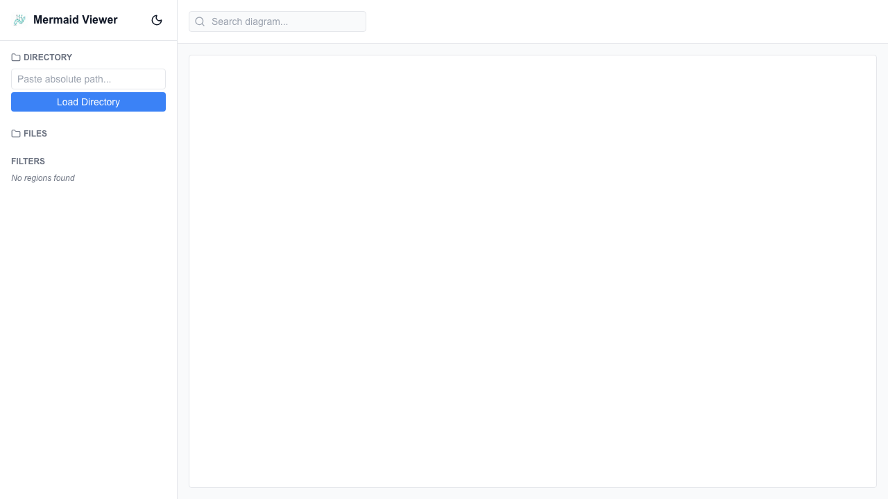

# Mermaid Sequence Diagram Viewer

A full-stack Next.js application designed to manage, visualize, and filter massive Mermaid diagrams (2000+ lines, 50+ flows). The tool acts as a local viewer that allows users to seamlessly switch between `.mmd` files in a directory, selectively hide/show regions (flows, edge cases, notes), and perform custom searches within the rendered diagram.



## Features

- **File Watching & Live Reload**: Automatically updates the diagram within 1 second of saving the file, WITHOUT a full page refresh, retaining the current UI filter state.
- **Agnostic Pre-processor**: Uses custom tagging like `%% @region-start: type=value` to filter regions and smart cleanup to prevent Mermaid from throwing parse errors.
- **Dynamic UI & Filtering**: Sidebar file explorer, URL state persistence for filters, custom search highlighting, and theming.
- **Directory Selection**: You can easily switch between directories via the UI sidebar, or provide a default directory path when starting the app. Recent directories are remembered for quick access.
- **Visual Editing**: Edit sequence and flowchart diagrams in the browser — click to select elements and change their labels, types, colors, widths and dash patterns, add/delete participants, messages, nodes and edges, and create new diagrams by name and type. All edits auto-save to the `.mmd` file.

## Editing

Sequence and flowchart diagrams can be edited directly in the app:

- Edit mode is **on by default** when a diagram is opened: click a participant/node or a message/edge on the canvas. The side panel shows the fields for the selected element (Label, Type, Color, Width, Dash, Tags, Delete). The pencil toggle in the toolbar exits edit mode (adds `edit=0` to the URL) and re-enables it.
- Use the toolbar to **Add Participant** / **Add Message**, or click **New** in the Files list to create a new diagram — you choose the file name and the diagram type (sequence or flowchart).
- Every edit **auto-saves** to the `.mmd` file; the toolbar shows a Saving… / Saved indicator. External file changes are adopted live (SSE) with a "Reloaded from disk" notice.
- **Undo** (`Ctrl+Z`) and **redo** (`Ctrl+Y`) step through edits; the history is capped at 15 entries.
- Colors, tags and arrow styles persist in the `%% CONFIG:` header of the file (see `diagram-guidelines.md`, section 6).

To verify the feature by hand, follow the incremental checklist in [MANUAL_TEST_PLAN.md](./MANUAL_TEST_PLAN.md) — run one increment at a time and confirm the behavior before continuing. The automated suites (`npx vitest run`, `npx cypress run`) cover the same behaviors headlessly.

## How to Run Locally

### 1. Install dependencies

```bash
npm install
```

### 2. Start the development server

You can run the app and pass the directory containing your Mermaid `.mmd` diagrams as a command-line argument:

```bash
npm run dev -- /absolute/path/to/your/diagrams
```

*(If you don't provide a path, it will fall back to the `diagrams` folder in the project root.)*

Open [http://localhost:3000](http://localhost:3000) with your browser to see the result. 

### 3. Change Directory via UI

You can also dynamically load any directory directly from the web interface!
In the sidebar, use the **Directory** section to paste an absolute path to a folder on your system and click **Load Directory**. Your recent directories will be saved for quick access.

## LLM Context File / Skill (Artifact)

This project includes a bundled `diagram-guidelines.md` context file. 
This file acts as the instruction manual you feed to LLMs (like Claude, Gemini, or Codex) so they understand how to generate code compatible with this web app. It explains the custom `%% @region-start` syntax, demonstrates how to correctly nest flows and edge cases, and establishes visual styling rules.

## Advanced Configuration (Views & Actors)

You can add a `%% CONFIG: { ... }` JSON comment to the first line of your Mermaid diagrams to define **Saved Views** and **Actor Metadata**.

### Saved Views
Saved views allow you to quickly switch between different visible regions (e.g., hiding all edge cases).
You can save views directly from the UI, and they will be persisted to the `.mmd` file automatically.

### Actor Grouping & Filtering
You can attach metadata (like `color` or custom `keys`) to your actors within the `%% CONFIG:` JSON block.
```json
%% CONFIG: {"version": 1, "actors": {"Auth": {"color": "red", "keys": ["internal"]}, "DB": {"color": "red", "keys": ["internal", "storage"]}}}
```
This enables the UI to automatically provide toggles to:
- **Hide by Key or Color:** Toggle visibility of all actors that share a specific key or color.
- **Merge by Color:** Dynamically collapse and merge all actors of a specific color into a single participant box on the fly (e.g., turning all "red" microservices into one block) without altering the source code!
