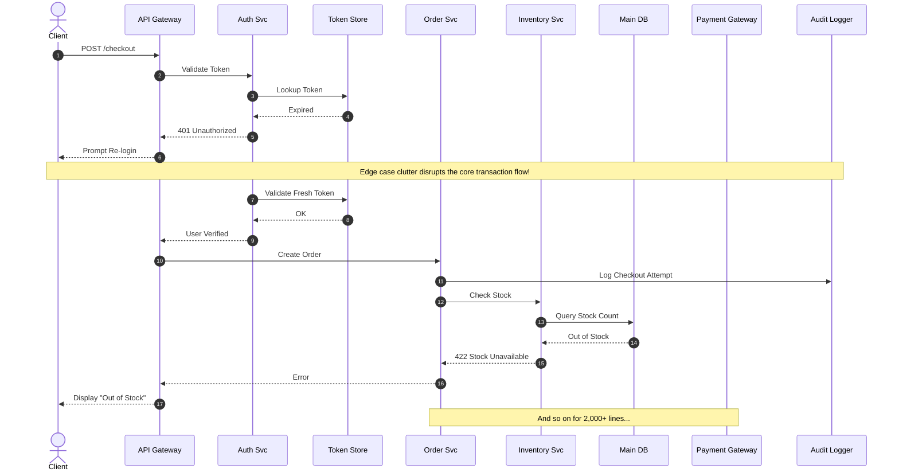
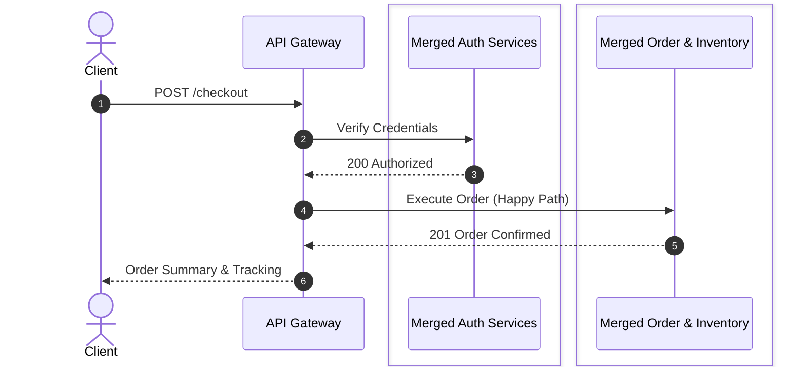
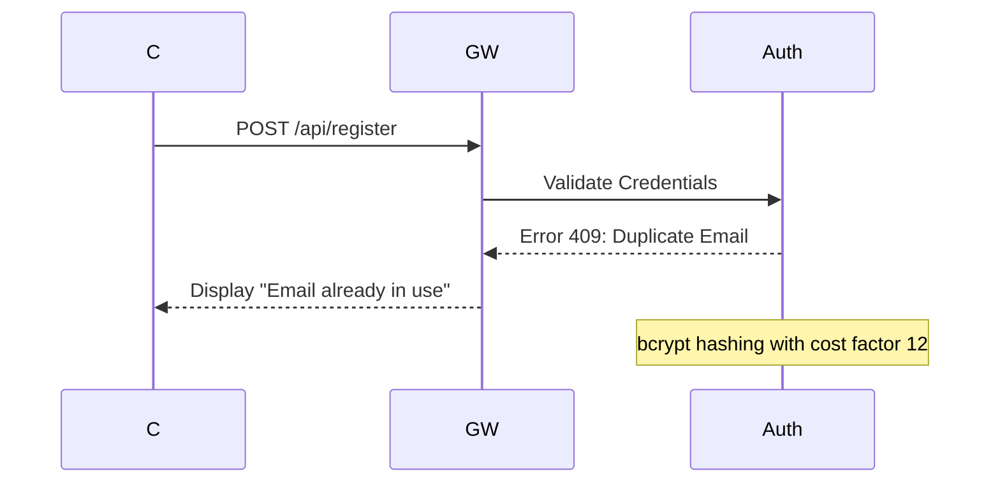

# Mermaid Sequence & Flowchart Viewer

> **Turn on the project and go through the tutorial.** Run `npm install && npm run dev`, open [http://localhost:3000](http://localhost:3000), and the app automatically loads `diagrams/tutorial.md` — a comprehensive, interactive, one-stop tutorial that walks you through every feature with live, hands-on diagrams. Work through it top to bottom, and by the end you will know how to use the software properly.

[](./LICENSE)
[](https://nextjs.org/)
[](https://mermaid.js.org/)
[](https://vitest.dev/)
[](https://www.typescriptlang.org/)

> **A local-first, bidirectional WYSIWYG editor and architectural viewer for massive Mermaid diagrams and Markdown documents with embedded diagrams (2,000+ lines, 50+ flows) with hierarchical layers, dynamic domain merging, zero syntax breakage, and interactive delighters.**

---

## Table of Contents

- [Interactive Tutorial](#interactive-tutorial)
- [The Gap: Why This Project Exists](#-the-gap-why-this-project-exists)
- [Quick Start & Build](#-quick-start--build)
- [Static Build (GitHub Pages / CDN)](#3b-static-build-github-pages--cdn-demo)
- [Solving The Diagram Maintainability Gap](#-solving-the-diagram-maintainability-gap)
  - [The Problem: Unmaintainable Monoliths](#the-problem-unmaintainable-monolithic-diagrams)
  - [The Solution: Layers & Dynamic Domain Merging](#the-solution-layered-views--dynamic-domain-merging)
  - [Zero-Config Structural Tags (Box & Subgraph Abstraction)](#zero-config-structural-tags-box--subgraph-abstraction)
- [WYSIWYG Canvas & Document Editing (Valid Mermaid Guarantee)](#-wysiwyg-canvas--document-editing-valid-mermaid-guarantee)
  - [Direct Canvas Manipulations](#1-direct-canvas-manipulation)
  - [Context-Sensitive Properties Panel](#2-context-sensitive-properties-panel)
  - [Safety & Reliability Safeguards](#3-safety--reliability-safeguards)
  - [Interactive Markdown Document Editor & Embedded Previews](#4-interactive-markdown-document-editor--embedded-previews)
- [Supported Diagram Types](#-supported-diagram-types)
  - [Sequence Diagrams](#1-sequence-diagrams-sequencediagram)
  - [Flowcharts](#2-flowcharts-flowchart)
- [Interactive Outliers & Visual Delighters](#-interactive-outliers--visual-delighters)
  - [Draggable & Resizable Markdown Sticky Notes](#1-draggable--resizable-markdown-sticky-notes)
  - [Sequential Animated Arrows & Motion Presets](#2-sequential-animated-arrows--motion-presets)
  - [Global Default Arrow Styling](#3-global-default-arrow-styling)
  - [Monaco Split-View & Live Line Diffing](#4-monaco-split-view--live-line-diffing)
  - [Resizable Workspace Sidebar](#5-resizable-workspace-sidebar)
  - [One-Click Productivity Knobs](#6-one-click-productivity-knobs)
  - [Standalone SVG Export](#7-standalone-svg-export)
- [Authoring Syntax & Configuration Guide](#-authoring-syntax--configuration-guide)
  - [Hierarchical Regions (`%% @region-start`)](#1-hierarchical-regions---region-start)
  - [Zero-Config Structural Subgraphs & Boxes](#2-zero-config-structural-subgraphs--boxes)
  - [Configuration Header (`%% CONFIG:`)](#3-configuration-header---config)
  - [LLM Context Guidelines](#4-llm-context-guidelines-diagram-guidelinesmd)
- [Saved Views & URL State Persistence](#-saved-views--url-state-persistence)
- [Architecture & Tech Stack](#-architecture--tech-stack)
- [Storage Backends (Pluggable Persistence)](#storage-backends-pluggable-persistence)
- [Testing & Quality Assurance](#-testing--quality-assurance)

---

## Interactive Tutorial

The project ships with a single, comprehensive tutorial file:
[`diagrams/tutorial.md`](./diagrams/tutorial.md). When you start the app with
no `?file=` parameter, the tutorial loads automatically.

The tutorial is a Markdown document with **16 parts** and **11 live, embedded
diagrams**, covering every feature hands-on:

| Part | Topic | What you learn |
|---|---|---|
| 0 | The Big Picture | File types, the bidirectional editing model |
| 1 | Viewing & Navigating | Pan, zoom, search, dark/light theme |
| 2 | Markdown Documents | WYSIWYG reading, inline prose editing, per-block tag toggles |
| 3 | Sequence Diagrams | Regions, tags, boxes, saved views, arrow styling & animations |
| 4 | Flowcharts | Node shapes, edge types, subgraphs, regions |
| 5 | Filtering & Layers | By Key (On/Merged/Clean/Off), By Color, By Region |
| 6 | Visual Editing | Create, move, retarget, delete elements; drag-to-connect |
| 7 | Presenter Mode | Walkthrough/step-through for sequence diagrams and flowcharts |
| 8 | Animated Arrows | 9 motion presets, sequential animation, color palette |
| 9 | Sticky Notes | Draggable/resizable notes with markdown & checklists |
| 10 | Saved Views & Sharing | Named views, URL state, teammate collaboration |
| 11 | Shift-Select & Deletion | Multi-select, wrap in block/region, cascade delete |
| 12 | Split View & Source Editing | Monaco editor, live line diffing, code mode |
| 13 | Creating New Diagrams | New file dialog, starter content for all types |
| 14 | Export & Productivity | SVG export, copy code, auto-save, live reload |
| 15 | Full Architecture Diagram | E-commerce platform combining all features |
| 16 | Quick Reference Card | Keyboard shortcuts, canvas interactions, filter cheat sheet |

Each part has prose explanations and **"Try it"** instructions you can follow
on the live diagram right next to the text.

---

## 🧭 The Gap: Why This Project Exists

Modern distributed systems and microservice architectures are notoriously difficult to document and maintain. Teams are routinely trapped between two flawed extremes:

| Approach | What Works | The Critical Failure Mode |
|---|---|---|
| **Text-as-Code (Mermaid CLI, PlantUML)** | Version-controlled in Git, diffable in PRs, co-located with code, easy for LLMs to generate. | **Unmaintainable at scale.** Monolithic diagrams turn into 2,000-line walls of text. Tweaking arrow endpoints, reordering execution steps, or renaming actors requires tedious manual regex editing. Visualizing edge cases clutters the happy path. |
| **Visual Canvas Tools (Lucidchart, Miro, Draw.io)** | Intuitive drag-and-drop, quick whiteboard iteration, easy stakeholder presentation. | **Broken Git workflows & developer silos.** Proprietary binaries or opaque XML blobs break git diffs, drift instantly from codebase realities, cannot be read or refactored by LLMs, and introduce vendor lock-in. |
| **Online Web Previews (mermaid.live)** | Instant visual preview of raw syntax. | **Pure read-only/scratchpad.** No direct canvas manipulation, no file-system watching, no domain merging, and no way to isolate flows or edge cases on massive architecture diagrams. |

### The Solution: A Bidirectional Bridge
This project fills the gap between **raw text diagrams** and **visual whiteboard canvas tools**:
1. **Single Source of Truth**: The `.mmd` plain-text files and `.md` markdown documents on your local disk remain the single source of truth. Every canvas click, drag, recolor, and retarget directly compiles into **clean, valid, idiomatic Mermaid syntax**.
2. **True WYSIWYG Manipulation**: Click, drag, reorder, connect lifelines, recolor, and retarget arrow endpoints directly on the rendered SVG canvas.
3. **Architectural Maintainability at Enterprise Scale**: Hierarchical layers (`%% @region-start`), zero-config structural subgraphs and boxes, dynamic microservice merging (collapsing 10 microservices into a single domain block on the fly), and non-destructive saved views.
4. **Interactive Delighters**: Draggable and resizable Markdown sticky notes with live task checklists, 9 animated arrow motion styles with chronological sequencing, bi-directional Monaco editor split-view with live line-diff highlighting, WYSIWYG markdown document editing with live diagram previews, and standalone SVG export.
5. **Pluggable Persistence**: One storage layer behind every read and write, with three swappable backends selected by environment variables — the local filesystem (default, zero-config), an in-memory store for scratchpads and testing, and Amazon S3 (or any S3-compatible endpoint) with true cross-process compare-and-swap. See [Storage Backends](#storage-backends-pluggable-persistence).

---

## 🚀 Quick Start & Build

The viewer runs locally on your machine, watching your local repository's diagrams directory via `chokidar` and Server-Sent Events (SSE). It seamlessly supports both standalone `.mmd` diagrams and `.md` markdown files containing embedded diagrams.

### Prerequisites
- Node.js 18+ (tested on Node 18, 20, 22)
- npm 9+

### 1. Installation
Clone the repository and install dependencies:
```bash
git clone https://github.com/your-org/mermaid-sequence-viewer.git
cd mermaid-sequence-viewer
npm install
```

### 2. Development Mode
Run the development server against the bundled demo diagrams or your own local directory:

```bash
# Run using the default ./diagrams folder
npm run dev

# Run and point to a specific directory on your machine
npm run dev -- /absolute/path/to/your/system/diagrams
```
> **Tip:** You can also pass the directory path directly: `node server.js /path/to/diagrams`. Once launched, open [http://localhost:3000](http://localhost:3000) in your browser. You can switch directories dynamically anytime in the UI sidebar!

By default, diagrams are stored on the local filesystem. Two more storage backends are available behind the same interface — see [Storage Backends](#storage-backends-pluggable-persistence) for the full configuration:

```bash
# In-memory storage (volatile; an amber banner warns about it)
STORAGE_BACKEND=memory MEMORY_STORAGE_SEED_DIR=./diagrams npm run dev

# Amazon S3 or an S3-compatible endpoint (e.g. LocalStack)
STORAGE_BACKEND=s3 S3_BUCKET=my-diagrams S3_ENDPOINT=http://localhost:4566 npm run dev
```

### 3. Production Build & Run
To compile and run an optimized production build:
```bash
# Build the Next.js application
npm run build

# Start the production server
npm run start
```

### 3b. Static Build (GitHub Pages / CDN Demo)

The app can be built as a **fully static site** — no server, no API routes, no database. The tutorial and all demo diagrams are bundled into the JavaScript, and the app runs entirely in the browser. This is perfect for hosting a live, explorable demo on GitHub Pages, Cloudflare Pages, Netlify, or any CDN.

```bash
# Build a static site (no base path — for local preview or custom domain)
npm run build:static
# Output: out/ directory — serve with any static file server

# Build a static site for GitHub Pages (with /mermaid-sequence-viewer base path)
npm run build:gh-pages
# Output: out/ directory — deploy to the gh-pages branch or via GitHub Actions
```

**What works in static mode:** Everything — pan, zoom, search, filters, canvas editing, presenter mode, animations, sticky notes, saved views, WYSIWYG markdown, SVG export. The tutorial file is read-only (changes are in-memory only and never saved).

**What's disabled:** File saving (no server), SSE live reload, new file creation, directory switching.

**GitHub Actions deployment:** A workflow at `.github/workflows/deploy-gh-pages.yml` automatically builds and deploys to GitHub Pages on every push to `main`. Enable GitHub Pages in your repo settings (Settings → Pages → Source: GitHub Actions).

**Local preview of the static build:**
```bash
npx serve out/
```

### 4. Running Verification & Test Suites
The project enforces high code quality with full automated testing suites:
```bash
# Run unit and integration tests (Vitest) - 1,500+ tests across 48 suites
npx vitest run

# Run linter
npm run lint

# Run type checker
npx tsc --noEmit

# Run headless end-to-end test suite (18 Cypress specs covering canvas interactions, persistence, sticky notes, and WYSIWYG markdown)
npx cypress run

# Run the storage e2e suite (a second Cypress suite that verifies the fs,
# memory, and s3 backends; the s3 leg uses LocalStack via Docker when available,
# else a local moto_server process — needs python3)
npm run test:e2e:storage        # all legs: fs, memory, s3
npm run test:e2e:storage:fs     # a single leg
```

---

## 🏗️ Solving The Diagram Maintainability Gap

Large architecture diagrams suffer from **diagram bloat**: when you model real-world production systems, every microservice, edge case, retry policy, and async queue gets crammed into a single unreadable visual tangle.

### The Problem: Unmaintainable Monolithic Diagrams
When an architecture diagram includes every edge case and every microservice participant, stakeholders cannot follow the core business transaction:



### The Solution: Layered Views & Dynamic Domain Merging
With this viewer, diagram authors tag regions and assign domain keys (`backend`, `storage`, `auth`). The UI then allows you to:
1. **Toggle Layers**: Hide edge cases or notes with a single click, viewing only the clean happy path.
2. **Merge by Domain**: Collapse individual services (`Auth Svc` + `Token Store` &rarr; `Merged Auth Zone`) dynamically without mutating the underlying file.
3. **Clean Mode**: Automatically eliminate internal chatter between merged services, retaining only external domain boundaries.



### Zero-Config Structural Tags (Box & Subgraph Abstraction)
Diagram grouping blocks automatically tag all participants, nodes, and messages inside them without requiring any `%% CONFIG:` header entries:
- **Sequence Diagrams**: Group participants using `box <title>` (e.g., `box Payment Service`).
- **Flowcharts**: Group nodes using `subgraph <title>` or `subgraph <id> [<title>]`.
- **Automatic Slugification**: The container's title is automatically slugified into a kebab-case tag key (e.g., `box Payment Service` &rarr; `payment-service`).
- **3-Tier Level of Abstraction**:
  - **On**: Full internal subsystem view showing all participants and internal messages.
  - **Merged**: Collapses all actors/nodes within the container into a **single consolidated actor/node** labeled with the container title. Internal interactions become self-calls.
  - **Clean**: Eliminates internal self-calls completely, displaying only external boundary messages entering or leaving the subsystem (the clean executive view).
  - **Off**: Completely hides the container, its members, and all internal messages (emptied container boxes are cleanly pruned).
- **Shareable Perspectives**: Works seamlessly with Saved Views and URL query parameters (`?merge_key=payment-service`, `?merge_clean_key=payment-service`, `?hide_key=payment-service`).

---

## 🎨 WYSIWYG Canvas & Document Editing (Valid Mermaid Guarantee)

Unlike whiteboard tools that generate arbitrary JSON or proprietary canvas objects, every edit performed on the canvas is processed by an AST/text parser that **rewrites the `.mmd` or `.md` file in place while strictly preserving formatting, comments, and structure**.

### 1. Direct Canvas Manipulation
- **Lifeline Drag-to-Connect**: Hover over any participant's lifeline to reveal an interactive drag handle with an enlarged grab target. Click and drag across to another lifeline to insert a message. A horizontal green slot indicator visualizes the exact insertion point.
- **Self-Pointing Loops**: Drag from an actor's lifeline handle and drop back onto the same actor to immediately create a self-calling message (`Client->>Client: validate`).
- **Endpoint Retargeting**: Click any existing message to expose its origin and recipient handles. Drag the arrowhead (`to`) onto another participant to retarget the recipient, or drag the tail (`from`) to change the sender.
- **Chronological Vertical Reordering**: Drag a message vertically up or down through the diagram to shift its chronological execution order among other steps.
- **Horizontal Participant Reordering**: Drag participant header boxes left or right to reorder service columns on the canvas.
- **Flowchart Node & Edge Dragging**: In flowcharts, drag from node to node to spawn connections, or drag nodes to reorder them along the layout flow axis (`TD` or `LR`).
- **Flowchart Chained Edge Editing**: Multi-hop edge declarations (`A --> B --> C --> D`) are fully parsed into distinct, selectable nodes and links. Editing any node, edge label, arrow style, or endpoint in a chain updates that link without breaking or corrupting the rest of the chain.
- **Precision Hit Paths**: Flowchart edges feature invisible, widened hit paths and hover affordances so even 1px thin or dashed lines can be selected accurately on the first click.
- **Canvas Keyboard Shortcuts**: `1` adds a participant (or flowchart node), `2` adds a sticky note, `Delete` / `Backspace` deletes the selected element (the same action as the panel's Delete button, including the cascade confirmation for notes), `Escape` clears the canvas selection or cancels an in-progress drag, and `Cmd/Ctrl+Shift+Z` redoes an undone edit (next to `Ctrl+Z` / `Ctrl+Y`). The shortcuts stay inert while typing in a text field.
- **Mouse Area Selection (Marquee)**: Drag across the canvas in edit mode to draw a selection rectangle and select multiple elements at once (or Shift+drag to add to current selection). Pan by holding the right (secondary) mouse/trackpad button + drag, `Space` + drag, middle-click drag, or dragging the canvas in view mode.
- **Double-Click Inline Label Editing**: Double-click any participant box, flowchart node, or message/edge label directly on the canvas to edit it in place — a small floating input opens over the element (sized to its on-screen text, so it stays aligned at any zoom). `Enter` or clicking away commits; `Escape` cancels. The edit runs through the same pipeline as the properties panel: the `.mmd` file is rewritten, the change joins the undo/redo stack, and it auto-saves.

### 2. Context-Sensitive Properties Panel
Clicking any element on the canvas opens the context-sensitive side panel:
- **Participants / Actors**:
  - Toggle representation between standard box (`participant`), stick-figure (`actor`), database cylinder (`database`), and message queue (`queue`).
  - Edit display labels and aliases.
  - Assign domain tags (`keys`) that feed the sidebar filtering controls.
  - Set custom accent colors and wrap multi-service clusters into `box` blocks.
- **Messages / Edges**:
  - Edit message labels in place with **arrow color and style preservation** (styles, tags, and animations are safely re-keyed in `%% CONFIG:` when labels change).
  - Cycle operator types through the full syntax catalog (`->`, `-->`, `->>`, `-->>`, `-x`, `--x`, `-)`, `--))`).
  - Configure stroke color, stroke width (1–10px), and line pattern (solid, dashed, dotted).
  - Lifeline activation control: *"Activate receiver (+)"* and *"Deactivate sender (-)"*.
  - Message tag inheritance: Toggle **Inherit service tags** (`keyMode: 'merged'` vs `'clean'`).
- **Global Default Arrow Style**:
  - When no element is selected, configure a diagram-wide fallback stroke color and stroke width (1–10px). All arrows and edges without per-arrow overrides automatically inherit this style.
- **Notes**:
  - Assign domain tags (`keys`) that feed the sidebar filtering controls; a note is hidden when all its tags are set to **Off** in *By Key*. Shift+click multi-selects notes to tag them in bulk.

### 3. Safety & Reliability Safeguards
- **Transient Syntax Error Resilience (Last-Good Render)**: Live edits that temporarily break Mermaid syntax keep the last valid diagram rendered on screen with an unobtrusive syntax error alert chip rather than crashing or throwing unhandled Mermaid DOM errors.
- **Two-Phase Cascade Deletion**: Deleting an actor or flowchart node detects all dependent messages or edges. A cascade confirmation modal details exactly what will be removed, ensuring no dangling references or broken syntax strings are left behind.
- **Bounded Undo / Redo**: Full `Ctrl+Z` / `Ctrl+Y` / `Cmd+Shift+Z` history stack capped at 15 edits. Reverting changes updates both the rendered SVG and the on-disk `.mmd` file.
- **Serialized Disk Persistence (`serialQueue`)**: All write-through saves pass through an asynchronous serialization queue to prevent race conditions and disk write interleaving.
- **Debounced Auto-Save & External Live Sync**: Edits auto-save to disk within 1 second. Edits made in external IDEs are detected via `chokidar` and hot-reloaded over SSE without wiping in-flight filter configurations.

### 4. Interactive Markdown Document Editor & Embedded Previews
The viewer provides native support for `.md` markdown files containing embedded ` ```mermaid ` code blocks, serving as a unified documentation and diagram workspace:

- **Dual-Mode Document Editing**:
  - **WYSIWYG Preview Mode (Default)**: Renders markdown prose (headings, paragraphs, blockquotes, lists, tables) as clean, readable typography. Click any prose block to open an inline, auto-sizing textarea scoped to that block's exact source range. Edits are applied using surgical, offset-based text splices and join the document undo/redo stack (`Ctrl+Z` / `Ctrl+Y`).
  - **Edit Mode**: Seamlessly switch to the embedded Monaco editor for raw Markdown editing with full syntax highlighting.
- **Live Embedded Diagram Rendering**:
  - Embedded ` ```mermaid ` fences render as interactive SVGs directly within the document flow.
  - Soft-fail handling: malformed or unclosed code fences display a helpful warning note rather than crashing the page or corrupting document layout.
- **Per-Diagram View & Tag Toggles in Markdown**:
  - Each embedded diagram block features interactive overlay controls: a **View selector dropdown** (cycling saved views) and **By Key tag toggle chips** (On/Off).
  - Preprocesses and filters the diagram in-memory without modifying the document file.
  - URL synchronization: Per-block selections are encoded into query parameters (`?mdview.0=Happy+Path&mdhide.0=cache`), making customized document views directly shareable and reload-persistent.
- **Click-to-Edit Diagram Bridge**:
  - Clicking any embedded diagram in the markdown preview opens it immediately in the visual diagram editor (`?diagram=<i>`), letting you drag lifelines, adjust styles, and configure views.
- **Targeted Block Saving & Post-Write Verification**:
  - Updating a diagram's saved view or layout inside a markdown document updates only that specific target fence on disk, leaving adjacent markdown prose untouched.
  - Post-write verification confirms the markdown file matches and all embedded diagrams remain extractable and syntactically valid.

---

## 📐 Supported Diagram Types

The editor provides full first-class support for the two most critical architectural diagram standards:

### 1. Sequence Diagrams (`sequenceDiagram`)
Designed for chronological communication flows, distributed consensus, protocol handshakes, and microservice transactions:
- **Syntax Features**: `participant`, `actor`, `database`, `queue`, `box [color] ... end`, `rect rgb(...) ... end`, `autonumber`, `Note over ...`, lifeline activation (`+`/`-`).
- **Canvas Interactions**: Lifeline-to-lifeline message dragging with enlarged grab targets, self-pointing loops, arrowhead/tail endpoint retargeting, message vertical slot reordering, participant column shifting, and one-click step numbering toggle.

### 2. Flowcharts (`flowchart`)
Designed for pipeline architectures, decision trees, state machines, and system dependency topologies:
- **Syntax Features**: `flowchart TD`, `flowchart LR`, `flowchart BT`, `flowchart RL`.
- **Node Shapes Supported**:
  - Rectangle: `[Standard Box]`
  - Rounded Rectangle: `(Rounded Box)`
  - Circle: `((Circle / Start-End))`
  - Rhombus / Decision: `{Condition / Decision}`
  - Database Cylinder: `[(Database / Persistent Storage)]`
  - Asymmetric / Flag: `>Asymmetric Banner]`
- **Edge Types Supported**:
  - Normal arrow: `-->`
  - Open link: `---`
  - Thick link: `==>`
  - Dotted link: `-.->`
  - Multi-directional / Bidirectional: `<-->`
- **Canvas Interactions**: Node-to-node edge drawing, node reordering along layout axis, chained edge editing (`A --> B --> C`), precision edge hit paths, and one-click orientation toggle (`TD` &harr; `LR`).

---

## ✨ Interactive Outliers & Visual Delighters

This project includes a collection of unique, high-craft features tailored specifically for architectural review and system design sessions:

### 1. Draggable & Resizable Markdown Sticky Notes
Add sticky notes directly to the diagram canvas to document architectural decisions, highlight open questions, or track review feedback during team syncs:
- **Canvas Anchored**: Sticky notes live on an overlay layer that scales and pans synchronously with the diagram canvas.
- **Smooth Corner Resizing**: Drag the bottom-right corner resize handle (`nwse-resize`) to resize cards to any dimensions. Typography automatically scales proportionally with card size. Dimensions persist under `notes[].width` and `notes[].height` in `%% CONFIG:`.
- **6 Pastel Colors**: Choose between Yellow (`amber`), Green (`emerald`), Blue (`sky`), Pink (`rose`), Orange (`orange`), and Purple (`purple`).
- **Rich Markdown Support**: Double-click to type formatted text supporting `**bold**`, `*italic*`, and inline `` `code` ``.
- **Interactive Task Checklists**: Supports `- [ ]` and `- [x]` syntax with live clickable checkboxes directly on the note!
- **Selectable & Taggable**: Click a card to select it — the properties panel shows its text, color and tags. Shift+click to multi-select: notes appear under **Tags by Element** just like actors and messages, and can be tagged as a group.
- **Filterable by Key**: Notes carry their own tags (persisted under `notes[].keys` in the `%% CONFIG:` header). Set a key to **Off** in the sidebar's By Key filter to hide the note; **On** brings it back (SVG export respects the filter too).
- **Persistent & Non-Destructive**: Notes persist in the `.mmd` file's `%% CONFIG:` JSON header so they survive page reloads and git commits.
- **Toolbar Toggle**: Show or hide all sticky notes with a single click (`Notes (N)` button).

### 2. Sequential Animated Arrows & Motion Presets
Bring static sequence diagrams to life by visualizing message velocity, packet transit, and network failures with animated SVG motion paths:
- **9 Handcrafted Motion Presets**:
  1. **Stream** (`flow`): Continuous fluid glow tracer representing standard async streams or event loops.
  2. **Glowing Orb** (`pulse`): High-energy glowing packet traveling along the message path.
  3. **Cyber Glow** (`cyber`): High-velocity neon particle trail for high-throughput RPCs.
  4. **Broken Sender** (`broken-sender`): HTTP 500 panic glitch with alarm pulsation at the origin lifeline.
  5. **Broken Network** (`broken-network`): Severed gap in transit simulating network drops, timeouts, or partition events.
  6. **Broken Receiver** (`broken-receiver`): Target barrier impact with shockwave burst indicating 4xx/5xx rejection or target crash.
  7. **Stutter** (`stutter`): Hesitant packet progression modeling jittery or congested links.
  8. **Ricochet** (`ricochet`): Bouncing tracer reflecting immediate rejection or boundary redirect.
  9. **Hesitate** (`hesitate`): Long dwell before sudden transit modeling high-latency or slow-responding downstreams.
- **Sequential Execution Timing**: Animated arrows in sequence diagrams trigger sequentially in chronological order down the diagram flow, accurately visualizing message transit order in distributed architectures.
- **10-Color Palette**: 5 positive hues (Emerald, Teal, Ocean, Indigo, Mint) and 5 error hues (Amber, Flame, Rose, Crimson, Ruby).
- **Convert Diagram**: A one-click button in the bottom motion bar that deterministically converts all diagram arrows into animated motion arrows.

### 3. Global Default Arrow Styling
Set a diagram-wide fallback stroke color and width (1–10px) in the Properties panel (`CONFIG.defaultArrowStyle`):
- Accessible when no element is selected under *"All arrows (default style)"*.
- Applies to all sequence arrows and flowchart edges without individual overrides.
- New arrows inherit the global default automatically; per-arrow styles override field-by-field.

### 4. Monaco Split-View & Live Line Diffing
For developers who prefer viewing code alongside the canvas, toggle the **Split View** (`Columns` icon in toolbar):
- **Embedded Monaco Editor**: Full VS Code-grade editor with syntax highlighting, line numbers, and search.
- **Live Line Diff Highlight**: When you perform a visual edit on the canvas (e.g., retargeting a message or changing an arrow style), the affected lines in the Monaco editor immediately light up with green diff gutter decorations (`diff-gutter-changed`) and background tint (`diff-line-changed`) for 5 seconds.
- **Mutual Edit Mode Locking**: Protects state by cleanly separating Visual Mode and Code Mode, with automatic focus switching.
- **Resilient Error Toast**: Hand-editing invalid Mermaid syntax displays an inline error alert while safely keeping the last valid diagram rendered on screen.

### 5. Resizable Workspace Sidebar
Drag the vertical divider on the left edge of the right sidebar to dynamically adjust the ratio between the diagram canvas and properties/source panels:
- Smooth window-level drag tracking that stays responsive even when dragging over the Monaco editor.
- Width is clamped safely (minimum 240px, keeping at least 320px for the diagram canvas).
- Independently persists widths for standard single-tab and split views in `localStorage` (`mermaid_sidebar_width` / `mermaid_sidebar_split_width`).

### 6. One-Click Productivity Knobs
- **Autonumbering Toggle** (`ListOrdered` icon): Instantly toggles `autonumber` on and off in sequence diagrams without manually modifying the header.
- **Orientation Switcher** (`ArrowDownUp` icon): Instantly toggles flowchart layout between vertical (`TD`) and horizontal (`LR`).
- **Copy Mermaid Code** (`Copy` icon): Copies the current, sanitized Mermaid code directly to your clipboard with instant checkmark feedback.
- **Search & Filter**: Search query highlights matching participants, node IDs, and message labels directly on the rendered SVG, auto-pans the canvas to the first match, and offers prev/next match navigation (with wrap-around and a `n/total` counter) in the zoom pill.
- **Zoom Controls & Fit to Screen**: A floating bottom-left canvas pill zooms in/out in absolute 50% steps (clamped to 20%–800%) with a live zoom-level readout, and **Fit to Screen** scales the whole diagram into the viewport (never zooming in past 100%). Mouse-wheel zoom and drag panning keep working as before.
- **Dark / Light Theme**: Seamlessly maps Mermaid rendering between clean high-contrast dark mode and crisp print-ready light mode.

### 7. Standalone SVG Export
Click **Export SVG** in the toolbar to export the current diagram:
- Packaged with full XML namespaces (`xmlns="http://www.w3.org/2000/svg"`, `xmlns:xlink="http://www.w3.org/1999/xlink"`).
- Injects standalone XML declaration (`<?xml version="1.0" standalone="no"?>`).
- Preserves all custom line widths, dash patterns, animations, and element colors.
- Embeds canvas sticky notes with rich markdown formatting and checklists for complete visual parity.
- Ready for zero-distortion inclusion in technical wikis, GitHub READMEs, architecture reviews, and keynote presentations.

---

## 📝 Authoring Syntax & Configuration Guide

### 1. Hierarchical Regions (`%% @region-start`)
Wrap flows, edge cases, and optional subsystems in custom comments. The pre-processor conditionally strips inactive regions and safely cleans up dangling syntax (like orphaned `alt/end` blocks or dangling connectors).



#### Pre-processor Safety Rules
- **Nesting**: Regions can be arbitrarily nested (e.g., an edge case or note inside a flow).
- **Participant Scope**: Keep shared participants outside regions. Flow-specific participants defined inside a region disappear cleanly when that region is toggled off.
- **Soft-Fail Parsing**: Unmatched or malformed region tags trigger a soft-fail warning toast without crashing the viewer or corrupting the canvas.

### 2. Zero-Config Structural Subgraphs & Boxes
Grouping blocks implicitly tag all participants and messages within them without requiring any `%% CONFIG:` entries:
- **Sequence diagrams**: Use `box <title>` around participants.
- **Flowcharts**: Use `subgraph <title>` or `subgraph <id> [<title>]`.
- **Slugified Keys**: The container title converts to a kebab-case slug (`box Payment Gateway` &rarr; `payment-gateway`).
- **Dynamic Collapse**: Setting the key to **Merged** in the By Key filter collapses the group into a single actor/node; **Clean** removes internal self-calls leaving only boundary flows; **Off** removes the group and its contents.

### 3. Configuration Header (`%% CONFIG:`)
The first line of any `.mmd` file can store non-destructive metadata. This header is managed automatically by the UI:

```json
%% CONFIG: {"version":1,"views":[{"name":"Happy Path","hiddenPaths":["flow=login/edge-case"]}],"actors":{"Auth":{"color":"red","keys":["backend"]}},"arrows":[{"from":"C","to":"GW","color":"#00ff9d","animation":"pulse"}],"defaultArrowStyle":{"color":"#94a3b8","width":2},"notes":[{"id":"note_1","x":100,"y":50,"width":160,"height":120,"text":"Review timeout threshold","color":"yellow"}]}
```

#### JSON Schema Reference
```typescript
interface DiagramConfig {
  version: number;
  views?: SavedView[];
  actors?: Record<string, ActorMetadata>;
  arrows?: ArrowStyle[];
  defaultArrowStyle?: ArrowStyleDefaults;
  noteTags?: NoteTagEntry[];
  notes?: StickyNote[];
}

interface ActorMetadata {
  color?: string;     // Hex or CSS color
  keys?: string[];    // Domain tags feeding "By Key" filter
}

interface ArrowStyleDefaults {
  color?: string;     // Fallback stroke color for all arrows
  width?: number;     // Fallback stroke width (1–10)
}

interface ArrowStyle {
  from: string;
  to: string;
  label?: string;
  occurrence?: number;
  color?: string;
  width?: number;
  dash?: 'solid' | 'dashed' | 'dotted';
  animation?: ArrowAnimationType;
  keys?: string[];
  keyMode?: 'merged' | 'clean';
}

type ArrowAnimationType =
  | 'none'
  | 'flow'
  | 'pulse'
  | 'cyber'
  | 'broken-sender'
  | 'broken-network'
  | 'broken-receiver'
  | 'stutter'
  | 'ricochet'
  | 'hesitate';

interface NoteTagEntry {
  over: string[];     // Participant IDs spanned by the note
  text: string;       // Note text identifier
  occurrence?: number;
  keys?: string[];    // Tags for hiding sequence notes
}

interface StickyNote {
  id: string;
  x: number;
  y: number;
  width?: number;     // Custom card width in pixels
  height?: number;    // Custom card height in pixels
  text: string;
  color?: 'yellow' | 'green' | 'blue' | 'pink' | 'orange' | 'purple';
  keys?: string[];    // The note's own tags (hide keys)
}
```

### 4. LLM Context Guidelines (`diagram-guidelines.md`)
This repository includes a dedicated instruction manual: [`diagram-guidelines.md`](./diagram-guidelines.md).
- **Purpose**: Feed this file into LLM coding assistants (Claude, Gemini, ChatGPT) as system instructions or skill context.
- **Outcome**: The LLM will automatically generate diagrams formatted with valid `%% @region-start` boundaries, kebab-case flow naming, and valid `rect` groupings that render out of the box with this viewer.

---

## 🔗 Saved Views & URL State Persistence

Collaboration in architectural design requires sharing exact perspectives:
- **Saved Views**: Define named perspectives (e.g., *"Core Happy Path"*, *"Order Processing Focus"*, *"Security Audit"*). Saved views persist to the `.mmd` header and can be switched via the sidebar.
- **URL Synchronization**: Every filter toggle, active flow, search query, theme selection, and per-diagram markdown state is synchronized to the browser URL:
  ```
  http://localhost:3000/?file=complex.mmd&theme=dark&q=Auth&edit=1&merge_clean_key=payment-service
  ```
  For markdown documents with embedded diagrams:
  ```
  http://localhost:3000/?file=architecture.md&mdview.0=Happy+Path&mdhide.1=deprecated-api
  ```
- Send the URL to teammates; when they open it, their viewer loads the exact diagram, search term, and view configuration instantly.

---

## 🏛️ Architecture & Tech Stack

```
mermaid-sequence-viewer/
├── server.js                     # Custom Node.js HTTP server + CLI directory argument resolver
├── src/
│   ├── app/                      # Next.js App Router (pages & SSE event streams)
│   │   ├── api/events/route.ts   # Server-Sent Events (SSE) live-reload stream
│   │   ├── api/file/[filename]/  # Read & debounced write-through auto-save endpoint
│   │   ├── api/files/route.ts    # Directory indexer & file listing (.mmd and .md)
│   │   └── api/markdown/save/    # Targeted markdown block saving & verification
│   ├── components/               # React client components
│   │   ├── ClientPage.tsx        # Top-level coordinator: state, auto-save, undo/redo
│   │   ├── DiagramViewer.tsx     # Canvas renderer, SVG zoom/pan, lifeline drag handles
│   │   ├── EditorPanel.tsx       # WYSIWYG element properties panel & cascade deletion
│   │   ├── MarkdownEditor.tsx    # Dual-mode Markdown editor (WYSIWYG preview & Monaco edit)
│   │   ├── WYSIWYGEditor.tsx     # Interactive block-based document editing surface
│   │   ├── WYSIWYGBlock.tsx      # Inline auto-sizing block editor for markdown prose
│   │   ├── MermaidBlockPreview   # Live embedded diagram preview with view/tag overlays
│   │   ├── SourceCodePanel.tsx   # Monaco editor split-view & live line-diff highlighter
│   │   ├── StickyNote.tsx        # Draggable & resizable canvas sticky note with markdown
│   │   ├── AnimatedArrowSelector # Motion style selector & live SVG preview generator
│   │   └── BottomAnimatedArrowBar# Slide-up footer toolbar for animations & conversion
│   └── lib/                      # Core AST, preprocessing, and styling engine
│       ├── editor.ts             # Deterministic text transforms & Mermaid code modifier
│       ├── model.ts              # Abstract diagram model & element extractor
│       ├── preprocessor.ts       # Region stripper, syntax cleanup & actor merging
│       ├── styling.ts            # SVG post-processor, arrow colors, dash & motion paths
│       ├── svgmap.ts             # SVG DOM to model element coordinate mapper
│       ├── subgraphTags.ts       # Zero-config box & subgraph title slugification
│       ├── markdownBlocks.ts     # Markdown AST block parser & surgical text splices
│       ├── markdownSave.ts       # Markdown embedded diagram block updater & verifier
│       ├── diagramView.ts        # Diagram view state resolution & URL encoding helpers
│       ├── serialQueue.ts        # FIFO queue primitive behind the storage write queue
│       ├── storage/              # Pluggable storage layer (fs / memory / s3 backends)
│       │   ├── types.ts          # StorageBackend interface & StorageError taxonomy
│       │   ├── fileSystemBackend.ts  # Default backend: atomic verified writes, chokidar watch
│       │   ├── memoryBackend.ts  # Volatile in-memory namespaces (scratchpads/testing)
│       │   ├── s3Backend.ts      # S3 backend: ETag compare-and-swap, polling watch
│       │   └── index.ts          # Backend selection (globalThis singleton) & write queue
│       └── views.ts              # %% CONFIG: parser, serializer & sticky note state
├── diagrams/                     # Bundled example diagrams & fixtures
└── diagram-guidelines.md         # Context file for LLM diagram generation
```

---

## Storage Backends (Pluggable Persistence)

Everything the app persists — `.mmd` diagrams, `.md` documents, and the `%% CONFIG:` headers inside them — goes through one storage layer (`src/lib/storage/`) behind a common `StorageBackend` interface. Three interchangeable backends implement it, selected by environment variables. **Zero-config compatibility:** with no variables set, the app uses the **fs** backend against the local `./diagrams` directory, exactly as it always has.

### Configuration

| Variable | Values | Default | Description |
|---|---|---|---|
| `STORAGE_BACKEND` | `fs` \| `memory` \| `s3` | `fs` | Selects the backend. An unknown value fails the boot, not a request. |
| `DIAGRAMS_DIR` | path | `./diagrams` | (fs) Diagrams directory; also set by the CLI argument (`node server.js /path/to/dir`). |
| `MEMORY_STORAGE_SEED_DIR` | path | unset | (memory) Directory whose `.mmd`/`.md` files seed the `default` namespace at boot. |
| `S3_BUCKET` | bucket name | — | (s3) Required; a missing bucket fails the boot. |
| `S3_ENDPOINT` | URL | unset | (s3) Custom endpoint, e.g. LocalStack at `http://localhost:4566`. Implies path-style addressing and `test`/`test` credentials. |
| `S3_REGION` | region | `us-east-1` | (s3) Region for the S3 client. |
| `S3_FORCE_PATH_STYLE` | `true` \| `false` | path-style when `S3_ENDPOINT` is set | (s3) Force path-style URLs (needed by most S3-compatible endpoints). |
| `S3_POLL_INTERVAL_MS` | milliseconds | `0` (off) | (s3) Enables the polling change-watcher that powers live reload for external writes. |
| `AWS_ACCESS_KEY_ID` / `AWS_SECRET_ACCESS_KEY` | credentials | `test` / `test` when `S3_ENDPOINT` is set | (s3) Credentials. Without an endpoint, the default AWS provider chain is used. |
| `PORT` | port | `3000` | Server port. |

```bash
# In-memory storage (nothing is persisted; an amber banner warns about it)
STORAGE_BACKEND=memory MEMORY_STORAGE_SEED_DIR=./diagrams npm run dev

# Amazon S3 (or an S3-compatible endpoint such as LocalStack)
STORAGE_BACKEND=s3 S3_BUCKET=my-diagrams \
  S3_ENDPOINT=http://localhost:4566 S3_POLL_INTERVAL_MS=1000 \
  npm run dev
```

### What `dir` means per backend

The UI's directory concept (`?dir=` on the API and in the page URL) maps onto each backend's native hierarchy:

| Backend | `?dir=` maps to | No `?dir=` | Volatility |
|---|---|---|---|
| `fs` | A filesystem path (tilde-expanded, absolute) | The diagrams directory (`DIAGRAMS_DIR` / CLI argument) | Persistent on disk |
| `memory` | A namespace key (no control characters) | `default` | Lost on server restart — an amber banner warns about this |
| `s3` | An object-key prefix (leading/trailing slashes stripped, no `..` segments) | `''` — the bucket root | Persistent in the bucket |

File-name validation is identical on every backend (a single safe path component, at most 255 bytes), so a diagram that saves on one backend saves on all of them.

### Writes, compare-and-swap, and live reload

- **Atomic, verified writes.** Every write is atomic and verified by a byte-identical read-back; a mismatch fails with `verify-failed` and leaves nothing half-written. All writes run through one process-wide serial queue, so a read-modify-write can never interleave with another write.
- **Compare-and-swap.** Markdown embedded-diagram saves re-read the file and refuse to write when its version changed since it was read (sha256 on fs/memory, the object ETag on s3 — a pre-write `GetObject` fast-fail plus `IfMatch` on `PutObject`). A mismatch fails with `conflict` and writes nothing. Whole-file saves are last-writer-wins.
- **Live reload.** `fs` watches each directory with chokidar (instant). `s3` polls `ListObjectsV2` and diffs ETag/LastModified — only when `S3_POLL_INTERVAL_MS` > 0 (S3 event notifications are not used). `memory` has no watcher by design: there is no external writer into a process-local map, and changes made through the app's own API are pushed to open pages through the shared in-process event emitter.
- **Documented divergences.** An empty S3 prefix cannot "exist": `/api/dir-check` reports `exists: false` for a prefix holding no objects (and answers `exists: false` without probing when no `?dir=` is given at all; it never creates a directory). The memory backend cannot fail — the save-error paths are unreachable there by construction.

### Error codes

Route handlers map storage failures to stable machine-readable codes (`src/lib/storage/types.ts`):

| `code` | HTTP | Meaning | Client save indicator |
|---|---|---|---|
| `invalid-name` | 400 | File name or dir failed validation | "Contents aren't saved: …" |
| `not-found` | 404 | File (or dir) does not exist | "Contents aren't saved: …" |
| `conflict` | 409 | Compare-and-swap version mismatch (markdown save jobs report it as job code `conflict`) | "The file changed on disk; reload it before saving" + conflict notice |
| `forbidden` | 403 | Permission denied | "Contents aren't saved: …" |
| `too-large` | 413 | Payload/key over the backend's limit | "Contents aren't saved: …" |
| `unavailable` | 503 | Backend unreachable or misconfigured | "Storage unavailable: …" |
| `verify-failed` | 500 | Read-back after write is not byte-identical | "Contents aren't saved: …" |
| `unknown` | 500 | Anything else | "Contents aren't saved: …" |

### Running the test suites

Two Cypress suites run against different servers; the main suite is unchanged (fs backend, `http://localhost:3000`):

```bash
# Main e2e suite (fs backend, port 3000)
npm run test:e2e          # or: npx cypress run

# Storage e2e suite (port 3100; one leg per backend — the runner boots the
# server and, for s3, a local S3 test server; see below)
npm run test:e2e:storage        # all legs: fs, memory, s3
npm run test:e2e:storage:fs     # a single leg
npm run test:e2e:storage:memory
npm run test:e2e:storage:s3
```

The storage suite (`cypress.storage.config.ts`) runs the main-suite specs that round-trip data through storage plus the backend-specific specs in `cypress/storage-e2e/` (scenario matrix E1–E13: surface, dirs, save conflict, live reload, error modes). On the memory leg the save-error scenario (E11) is reported as pending — an in-memory backend cannot fail by construction. `markdown-persistence` stays in the main suite only: it seeds by writing straight to disk, which only the fs backend can observe.

The s3 leg needs a local S3 endpoint, provided by `scripts/s3-test-server.mjs` in one of two modes: **LocalStack in Docker** via `@testcontainers/localstack` (the default when a Docker daemon answers — this is what CI uses), or — with no Docker — a **local `moto_server` process** (`pip install 'moto[server]'`, auto-provisioned into `.venv-s3/` on first use; needs python3). Both modes bind the same fixed port (`S3_E2E_PORT`, default 4566) so the endpoint survives the error-mode test's down/up cycle; both are in-memory, so the suite re-creates the bucket and re-seeds fixtures after a restart. Force a mode with `S3_E2E_SERVER=testcontainers|moto`; the unit/conformance s3 leg accepts either endpoint via `STORAGE_TEST_S3_ENDPOINT`.

The unit/conformance suite covers the storage layer itself; its s3 leg is enabled by pointing it at an endpoint:

```bash
npx vitest run src/lib/storage                                              # fs + memory legs
STORAGE_TEST_S3_ENDPOINT=http://localhost:4566 npx vitest run src/lib/storage  # + s3 conformance leg
```

---

## 🧪 Testing & Quality Assurance

The codebase is built with strict Test-Driven Development (TDD) principles to ensure zero diagram corruption:

```bash
# Execute Vitest test suite
npx vitest run
```

End-to-end (Cypress) — two suites, see [Storage Backends](#storage-backends-pluggable-persistence) for details and the per-backend legs:

```bash
# Main suite (fs backend, port 3000)
npm run test:e2e

# Storage suite (port 3100; fs/memory/s3 legs — the s3 leg uses LocalStack via
# Docker when available, else a local moto_server process; needs python3)
npm run test:e2e:storage
```

### Verified Test Coverage Highlights (1,500+ Tests across 48 Suites)
- **Agnostic Pre-processor**: Validates nested regions, unclosed tags, dangling `alt`/`end` blocks, and multi-tier region paths.
- **Zero-Config Subgraph & Box Tagging**: Tests automatic title slugification, 3-tier merging (On, Merged, Clean, Off), and empty container cleanup across sequence and flowchart diagrams.
- **WYSIWYG Transformations & Chained Edges**: Tests participant renames, lifeline creations, self-pointing loops, endpoint retargeting, arrow style injections, multi-hop flowchart chained edges (`A --> B --> C`), and cascade deletions.
- **Actor & Service Merging**: Tests collapsing participants by tag/color, rewriting external arrows, and stripping internal self-calls in Clean mode.
- **Sticky Notes & Animations**: Tests drag and corner-resize coordinate math, responsive font scaling, markdown parsing, CONFIG serialization, and chronological sequential animation timing.
- **Interactive Markdown WYSIWYG**: Tests block-level AST parsing, scoped inline textarea editing, targeted block replacement, and per-diagram view/tag overlay controls.
- **Persistence & Serialization**: Verifies the serialized storage write queue (`serialQueue` behind `storageWriteQueue`), post-write verification, debounced write-throughs, SSE echo cancellation, and external disk change adoption.
- **Storage Backends**: A shared conformance suite runs against every backend (fs, memory, s3) — byte-identical round-trips (CRLF/unicode/emoji), atomic verified writes, compare-and-swap conflicts, S3 pagination beyond 1000 keys, and the full error taxonomy — plus a separate Cypress suite (11 specs per leg) covering the E1–E13 scenario matrix on each backend.
- **Undo / Redo History**: Confirms strict 15-entry bounded history and disk state synchronization.
- **18 Cypress End-to-End Suites (main) + 11 per storage leg**: Comprehensive browser-level tests covering canvas interaction, lifeline drag handles, flowchart hit targets, sticky note drag/resize/selection, pan/zoom, and markdown persistence.

---

## 📄 License

This project is licensed under the MIT License — see the [LICENSE](./LICENSE) file for details.
