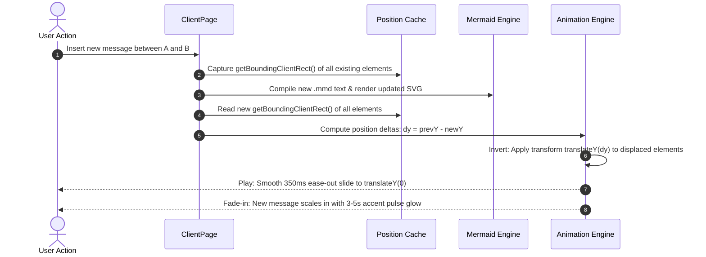

# Deep Exploration & Architectural Blueprint: Interactive Sequence Diagram Editing

**Date:** 2026-10-12  
**Status:** Architecture & Specification Locked (Ready for implementation in follow-up session)  
**Target File:** [`SEQUENCE_DIAGRAM_EDITING_EXPLORATION.md`](file:///Users/zlatinstanimirov/code/mermaid_sequence_diagram/SEQUENCE_DIAGRAM_EDITING_EXPLORATION.md)

---

## 1. Executive Summary & Vision

This document details the architecture, UX design, data model transforms, and animation pipeline for the **Sequence Diagram visual editing experience**. 

The goal is to deliver an intuitive, direct-manipulation editing experience (similar to Lucidchart or Miro) while strictly preserving plain-text Mermaid (`.mmd`) as the single source of truth.

---

## 2. Locked Decisions (From Q&A)

| # | Question / Capability | Decision / Chosen Design |
|---|---|---|
| **1** | **Positioning Approach** | **Semantic layout constraints**: Horizontal column order for participants, vertical chronological slots for messages. **Plus:** Orientation toggle (Vertical vs Horizontal) in the top toolbar near Undo/Redo. |
| **2** | **Rebalancing Animation** | **FLIP vertical slide animation (350ms ease-out)** for displaced elements + smooth fade-in for newly inserted elements. |
| **3** | **Visual Cue for New Connections** | **Accent pulse highlight** (emerald/cyan glow) on newly inserted messages lasting ~3–5 seconds with a gentle fade. |
| **4** | **Drawing Connections on Canvas** | **Hover-activated lifeline drag handle**: Hovering anywhere on a lifeline reveals a circular handle; dragging to another lifeline creates a message. |
| **5** | **Message Placement & Snapping** | **Snap to nearest message slot** with a real-time horizontal green drop indicator line. |
| **6** | **Participant Representation** | Support both standard box (`participant`) and stick-figure (`actor`) with an instant toggle in the properties panel. |
| **7** | **Arrow Style Defaults** | Standard clean arrow by default, with rich animated motion presets and colors applied via the bottom bar or panel. |
| **8** | **Message Label Length** | Let Mermaid expand column distance naturally based on label width to preserve typography and spacing. |
| **9** | **Activation Boxes** | Toggle in the message properties panel to control lifeline activation: *"Activate receiver (+)"* / *"Deactivate sender (-)"*. |
| **10** | **Participant Grouping (Boxes)** | Allow shift-selecting multiple participants to wrap them in colored container box blocks (`box [color] Title ... end`). |

---

## 3. UI & Canvas Interaction Specifications

### 3.1 Top Toolbar: Orientation Toggle
Placed directly adjacent to the **Undo / Redo** controls:
- **Button**: An orientation switcher button with icons (e.g. `ArrowDownUp` for Vertical vs `ArrowLeftRight` for Horizontal).
- **Behavior**:
  - For Flowcharts / Component diagrams: Switches between `flowchart TD` and `flowchart LR`.
  - For Sequence diagrams: When supported or configured, alters layout flow or spacing directives.

### 3.2 Lifeline Hover & Message Dragging
1. **Hover Target**:
   - Moving the cursor near any participant's vertical lifeline (within 20px hit radius) displays a floating circular drag handle (`●`) at the cursor Y level.
2. **Dragging Action**:
   - Pressing and dragging from the handle draws a live rubberband connection line to the cursor (`x1, y1` to `x2, y2`).
   - As the cursor approaches another lifeline, a magnetic snap rect highlights the target lifeline.
3. **Drop Slot Indicator**:
   - A green horizontal indicator line (`#22c55e`, stroke-width 3) displays between the two messages where the new message will be inserted.
4. **Insertion**:
   - Releasing the mouse commits the edit, parses syntax, auto-selects the new message in the properties panel, and triggers the rebalance animation.

### 3.3 Message Endpoint Retargeting & Vertical Reordering
- **Head & Tail Handles**: The selected message displays distinct circular handles on its origin and destination.
  - Dragging the arrowhead retargets the recipient.
  - Dragging the tail retargets the sender.
- **Vertical Reordering**: Dragging the message body up or down shifts its chronological execution order among other messages.

### 3.4 Activation Boxes & Grouping
- **Activation (`+` / `-` / `activate` / `deactivate`)**:
  - In `EditorPanel`, when a message is selected, checkboxes for *"Activate target lifeline"* and *"Deactivate source lifeline"* allow toggling activation blocks.
- **Grouping (`box ... end`)**:
  - Shift-clicking two or more participants displays a *"Group into Box"* action with color and title fields, writing a `box rgba(...) Group Name ... end` block into the Mermaid source.

---

## 4. Rebalancing & Transition Engine (FLIP Animations)

When a message is inserted, deleted, or reordered, Mermaid recomputes the diagram layout, causing lower messages and participants to shift. To avoid jarring jumps:



1. **New Element Entrance**:
   - Newly inserted arrow and label start at `opacity: 0; transform: scaleY(0.7)`.
   - Transitions to `opacity: 1; transform: scaleY(1)` over 300ms, with an emerald accent glow that gently fades over 3–5 seconds.
2. **Existing Element Displacement**:
   - Displaced messages calculate `dy = prevY - newY`.
   - Elements smoothly animate using the Web Animations API:
     ```ts
     el.animate(
       [
         { transform: `translateY(${dy}px)` },
         { transform: 'translateY(0px)' }
       ],
       { duration: 350, easing: 'cubic-bezier(0.2, 0.8, 0.2, 1)' }
     );
     ```
3. **Lifeline Extension**:
   - Vertical lifeline SVG lines smoothly interpolate their `y2` attribute to accommodate added height.

---

## 5. Pure Text Transforms Specification (`src/lib/editor.ts`)

Every visual action maps to a pure function `(rawCode, config, ...args) -> { code, config, warning? }`:

1. `addParticipant(code, config, name, kind: 'participant' | 'actor')`:
   - Appends or inserts participant at declaration header:
     `participant P as Name` or `actor U as User`.
2. `insertMessage(code, config, from, to, label, type, position: { type: 'before' | 'after' | 'bottom', key?: string }, activation?: { activateTarget?: boolean, deactivateSource?: boolean })`:
   - Inserts message line at exact line index with clean indentation.
3. `toggleActivation(code, messageKey, endpoint: 'target' | 'source', active: boolean)`:
   - Updates `+` / `-` operator or inserts matching `activate`/`deactivate` statements.
4. `groupParticipants(code, config, participantKeys: string[], title: string, color: string)`:
   - Wraps the specified participant declarations inside `box <color> <title> ... end`.
5. `toggleDiagramOrientation(code: string): string`:
   - Toggles flowchart direction (`TD` <-> `LR`).

---

## 6. Implementation Phases (For Follow-Up Session)

- **Phase 1: Pure Transforms & Tests**
  - Implement participant kind toggle (`actor` vs `participant`), activation transforms, and box grouping in `src/lib/editor.ts`.
  - Comprehensive unit test suite in `src/lib/editor.test.ts`.

- **Phase 2: Canvas Lifeline Drag & Drop Engine**
  - Add lifeline hover handle detection and rubberband connection drawing in `DiagramViewer.tsx`.
  - Drop slot calculation and green insert indicator line.

- **Phase 3: FLIP Rebalance Animation & Accent Glow**
  - Extend `animateMovedElements` to capture arrow paths and text labels.
  - Implement 350ms vertical FLIP glide and 3–5s accent pulse glow.

- **Phase 4: Top Toolbar & Inspector Panel Integration**
  - Add Orientation toggle button near Undo/Redo in `ClientPage.tsx`.
  - Add Actor type selector, Activation toggles, and Box grouping in `EditorPanel.tsx`.
