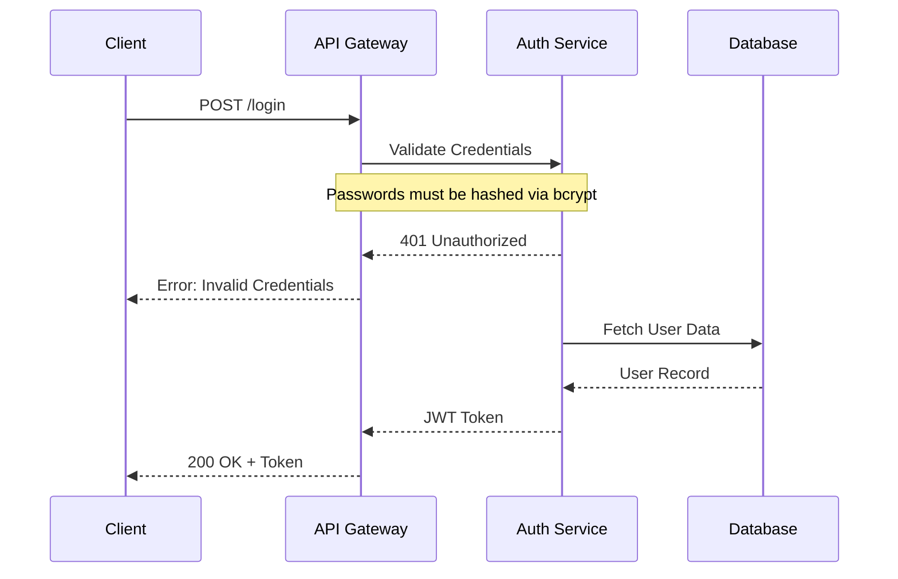

# Mermaid Diagram Authoring Guidelines

You are assisting in generating and editing a massive Mermaid sequence diagram. This diagram is rendered by a custom web application that allows the user to filter specific flows, edge cases, and notes.

To support this filtering, you MUST strictly adhere to the following custom syntax and visual standards.

## 1. Custom Tagging Syntax
The web app uses a custom pre-processor that reads specific Mermaid comments (`%%`) to conditionally render blocks of code. 

**Wrap all flows, edge cases, and notes in the following tags:**

### Starting a Region
Use `%% @region-start: type=value`
- **For a Flow**: `%% @region-start: flow=flow-name`
- **For an Edge Case**: `%% @region-start: edge-case=case-name`
- **For a Note**: `%% @region-start: note`

### Ending a Region
Use `%% @region-end`

**Important Rules:**
1. Regions CAN be nested (e.g., an edge case or a note inside a flow).
2. Everything inside the region will be hidden if the user disables that filter in the UI.
3. Keep core/shared participants OUTSIDE of any region so they are always loaded. However, participants that are *specific* to a certain flow or edge-case MUST be defined INSIDE that region. This ensures the actors disappear cleanly when the flow is toggled off.

## 2. Example Structure

## 3. Visual & Style Standards
When generating the diagrams, maintain these specific visual conventions:
1. **Notes**: Always use standard `Note over X,Y:` syntax. Do not apply inline HTML styling unless explicitly requested, rely on the web app's CSS.
2. **Background Colors (rect)**: Every flow MUST be wrapped in a `rect` block to visualize its background and grouped context. You can use colors (e.g., `rect rgb(255, 255, 255)`) to designate different types of flows or domains. Make sure the `rect` block stays strictly *inside* the `@region-start` boundaries of the flow so it correctly disappears when hidden.
3. **Flow Naming**: Keep flow names in `kebab-case` (e.g., `user-registration`, `checkout-process`). Additionally, you can add a `Note` or comment within the flow to clearly identify it visually if necessary.

## 4. Editing Process
When the user asks you to "add a flow" or "update an edge case":
1. Locate the correct place in the existing sequence diagram.
2. Ensure you add the correct `%% @region-start` and `%% @region-end` boundaries.
3. Output the fully updated `.mmd` code so it can be saved and live-reloaded by the app.
