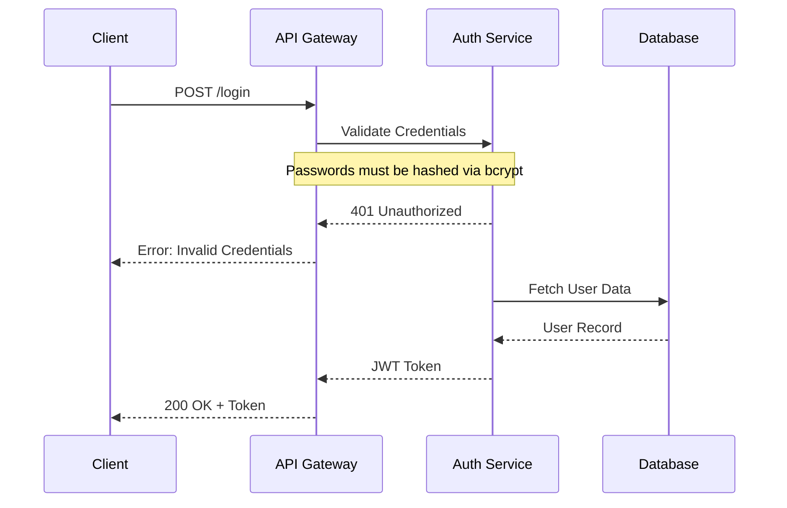

# Mermaid Diagram Authoring Guidelines

You are assisting in generating and editing a massive Mermaid sequence diagram. This diagram is rendered by a custom web application that allows the user to filter specific flows, edge cases, and notes.

To support this filtering, you MUST strictly adhere to the following custom syntax and visual standards.

## 1. Custom Tagging Syntax
The web app uses a custom pre-processor that reads specific Mermaid comments (`%%`) to conditionally render blocks of code. 

**Wrap all flows, edge cases, and notes in the following tags:**

### Starting a Region
Use `%% @region-start: type=value`
- **For a Flow**: `%% @region-start: flow=flow-name`
- **For an Edge Case**: `%% @region-start: edge-case=case-name`
- **For a Note**: `%% @region-start: note`

### Ending a Region
Use `%% @region-end`

**Important Rules:**
1. Regions CAN be nested (e.g., an edge case or a note inside a flow).
2. Everything inside the region will be hidden if the user disables that filter in the UI.
3. Keep core/shared participants OUTSIDE of any region so they are always loaded. However, participants that are *specific* to a certain flow or edge-case MUST be defined INSIDE that region. This ensures the actors disappear cleanly when the flow is toggled off.

## 2. Example Structure



## 3. Visual & Style Standards
When generating the diagrams, maintain these specific visual conventions:
1. **Notes**: Always use standard `Note over X,Y:` syntax. Do not apply inline HTML styling unless explicitly requested, rely on the web app's CSS.
2. **Background Colors (rect)**: Every flow MUST be wrapped in a `rect` block to visualize its background and grouped context. You can use colors (e.g., `rect rgb(255, 255, 255)`) to designate different types of flows or domains. Make sure the `rect` block stays strictly *inside* the `@region-start` boundaries of the flow so it correctly disappears when hidden.
3. **Flow Naming**: Keep flow names in `kebab-case` (e.g., `user-registration`, `checkout-process`). Additionally, you can add a `Note` or comment within the flow to clearly identify it visually if necessary.

## 4. Editing Process
When the user asks you to "add a flow" or "update an edge case":
1. Locate the correct place in the existing sequence diagram.
2. Ensure you add the correct `%% @region-start` and `%% @region-end` boundaries.
3. **Validate Annotations**: Before outputting the final diagram, double-check your tags:
   - Ensure every `%% @region-start` has a matching `%% @region-end` (no unclosed or unmatched tags).
   - Ensure tags use the correct syntax (`%% @region-start: type=value`).
   - Ensure that Mermaid blocks (`rect`, `alt`, `opt`, `loop`, `subgraph`) are properly closed and strictly contained *inside* the region boundaries without overlapping/interleaving with the region tags.
4. Output the fully updated `.mmd` code so it can be saved and live-reloaded by the app.

## 5. Configuration & Views (%% CONFIG)
The first line of the `.mmd` file can contain a `%% CONFIG: { ... }` JSON string to persist app state, including saved views and actor metadata.

**Example:**
`%% CONFIG: {"version":1,"views":[{"name":"Happy Path","hiddenPaths":["flow=login/edge-case"]}],"actors":{"Auth":{"color":"red","keys":["backend"]}}}`

- When defining actors, you can assign them a `color` and an array of `keys`. This allows the viewer to provide dynamic toggles to hide these actors by key/color or merge all actors of the same color into a single block. 

## 6. Visual Editing & CONFIG.arrows
The app can edit sequence and flowchart diagrams in place (the **Edit** toggle, `?edit=1`): click a participant/node or message/edge to change its label, type, color, width and dash; add participants/messages; delete elements (deleting a participant/node cascades to everything referencing it); and undo/redo (`Ctrl+Z` / `Ctrl+Y`, history capped at 15 entries). Edits auto-save to the `.mmd` file.

Arrow styles are persisted in the `%% CONFIG:` header under `arrows`:

```ts
interface ArrowStyle {
  from: string;                 // participant/node id in the RAW file
  to: string;                   // participant/node id in the RAW file
  label?: string;               // message/edge label; disambiguates same-endpoint arrows
  occurrence?: number;          // optional: nth arrow with the same (from,to,label), 0-based
  color?: string;               // stroke color, any CSS color
  width?: number;               // stroke width, 1-10
  dash?: 'solid' | 'dashed' | 'dotted';
}
```

**Rules:**
1. `from`/`to` are the **raw** ids exactly as written in the file (before any merge/hide transform). Styles are resolved against the post-transform actor names, so they follow merges: when actors merge by color/key, their arrow styles are rewritten to the merged actor and keep rendering (e.g. as a styled self-call). Styles whose endpoints are hidden become inert, because the arrows themselves are gone with the hidden actors.
2. `label` disambiguates arrows between the same pair of endpoints; `occurrence` (0-based) disambiguates duplicate arrows that share the same label.
3. Deleting an arrow removes its style entry; deleting a participant/node removes the styles of every arrow that referenced it. The header line is dropped automatically when `views`, `actors` and `arrows` are all empty.

**Example:**
`%% CONFIG: {"version":1,"actors":{"Auth":{"color":"red","keys":["backend"]}},"arrows":[{"from":"C","to":"API","label":"POST /login","color":"#e11d48","width":3,"dash":"dashed"}]}`
