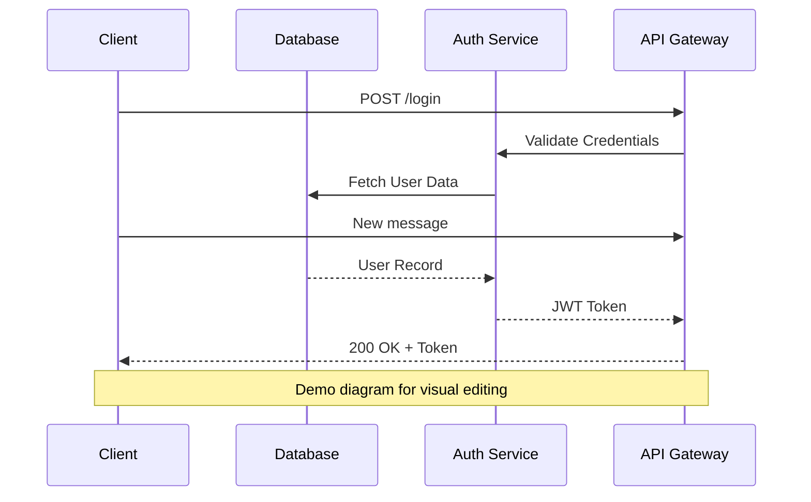
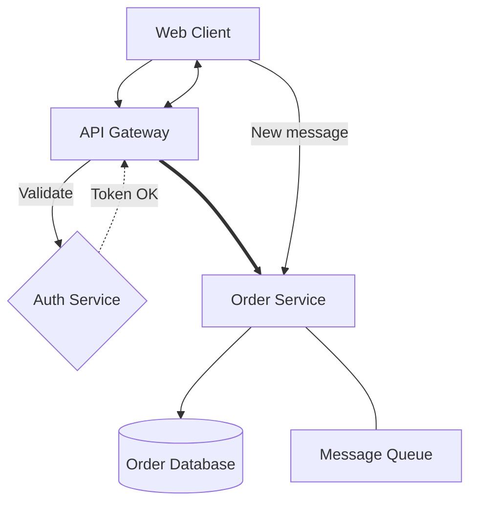

# Markdown Demo — Embedded Mermaid Diagrams

This file is a committed sample for testing **mermaid diagrams embedded in
markdown files** on a fresh checkout. Every `mermaid` fenced block below is
listed in the Files menu as a nested child of this file (with an **MD**
badge). Select one, toggle **Edit**, change it on the canvas or in the text
editor, and the save is written back into this file: only that fenced
block's content is replaced, the surrounding prose is untouched.

## Login flow (sequence diagram)

The first block carries a `%% CONFIG:` line, so canvas edits (colors, sticky
notes, saved views) round-trip through the markdown save. Its participants are
tagged (`frontend` / `backend`) and it has a saved view, so the preview's
per-block view dropdown and tag chips can be tried right here.



## Order pipeline (flowchart)



## Not a diagram

Fenced blocks with a non-mermaid language are ignored by the viewer.

```js
console.log("not a diagram");
```
