# Foliant Tutorial — Master the Mermaid Sequence & Flowchart Viewer

Welcome! This document is your one-stop tutorial. It lives inside the viewer, so
every diagram below is **live and interactive**. Read the prose, then try the
"Try it" steps on the diagram right next to it. By the end, you will know how
to use every feature of the app.

> **How to follow along:** Start the app (`npm run dev`), open
> [http://localhost:3000](http://localhost:3000), and select **tutorial.md**
> from the Files menu. This document opens in the **Markdown Preview** — a
> WYSIWYG reading mode with live, interactive diagrams embedded in the flow.

---

## Part 0 — The Big Picture

Foliant is a **local-first, bidirectional WYSIWYG editor and architectural
viewer** for Mermaid diagrams. It works with two kinds of files:

| File type | What it is | What you can do |
|---|---|---|
| `.mmd` | A standalone Mermaid diagram (sequence or flowchart) | View, edit on canvas, filter, animate, export |
| `.md` | A Markdown document with embedded ` ```mermaid ` blocks | Read like a document, edit prose inline, toggle tags per diagram, click any diagram to open it in the editor |

Every edit you make on the canvas is written back to the plain-text file as
clean, valid Mermaid syntax. There is no proprietary format — your files stay
readable in any text editor, version-controlled in Git, and generatable by LLMs.

---

## Part 1 — Viewing & Navigating the Canvas

Every diagram renders on an infinite canvas. You can pan, zoom, search, and
switch themes.

### Pan & Zoom
- **Drag** the canvas to pan.
- **Mouse wheel** or **pinch** to zoom.
- Use the **floating zoom pill** (bottom-left) for Zoom In / Zoom Out in 50%
  steps, a live percentage readout, and **Fit to Screen**.

### Search
- Type in the **Search** box (top toolbar) to highlight matching participants,
  node IDs, and message labels. Matches turn red/bold, and the canvas
  auto-pans to the first match.
- Use **Prev / Next** in the zoom pill to cycle through matches (`1/10`,
  `2/10`, …). The search query syncs to the URL (`?q=…`).

### Dark / Light Theme
- Click the **theme toggle** (sun/moon icon) in the toolbar to switch between
  dark mode and light mode. The diagram, panels, and styled arrows all adapt.

### Try it
The diagram below is a simple sequence diagram. Pan, zoom, search for
"JWT", and toggle the theme.

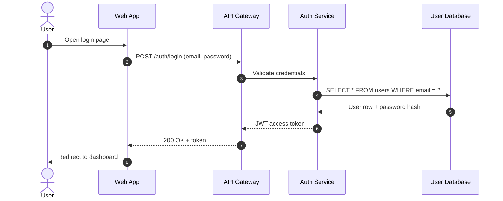

---

## Part 2 — Markdown Documents: The WYSIWYG Reader

This file **is** a Markdown document. Foliant renders it in a beautiful,
readable preview with live diagrams embedded in the flow. This is the default
mode for `.md` files.

### Two Editing Modes
- **Preview Mode (default):** Read the document. Click any prose paragraph or
  heading to edit it inline — a small textarea opens exactly over that block.
  Press `Enter` or click away to save. Undo/redo works with `Ctrl+Z` / `Ctrl+Y`.
- **Edit Mode:** Click the **Edit** toggle to switch to the embedded Monaco
  editor for raw Markdown editing with syntax highlighting.

### Per-Diagram Controls in Markdown
Each embedded diagram block can have its own **View dropdown** and **tag
toggle chips** — right in the preview, without opening the diagram editor.
These controls filter the diagram in-memory without modifying the file.

### Click-to-Edit Bridge
**Click any diagram** in the preview to open it in the full visual editor
(`?diagram=<index>`). Edit it there — drag lifelines, restyle arrows, save
views — and the change is written back into this Markdown file's fenced block.

### Try it
1. Click on this paragraph — a textarea opens. Type something, then press
   `Escape` to cancel.
2. Look at the diagram in Part 3 below — it has a **View dropdown** and **tag
   chips** in its header. Try them!
3. Click on any diagram to open it in the full editor.

---

## Part 3 — Sequence Diagrams: Regions, Tags & Saved Views

Sequence diagrams model chronological communication between services. Foliant
adds powerful layering on top: **regions** (`%% @region-start`), **domain
tags** (`keys`), **box groupings**, **saved views**, **arrow styling**, and
**animations**.

### Regions: Toggle Flows On/Off
Wrap sections in `%% @region-start: flow=…` / `%% @region-end` to create
toggleable layers. Edge cases nest inside flows. Notes get their own region
type.

### Domain Tags (Keys)
Assign tags like `backend`, `auth`, `frontend` to participants, messages, and
notes. Tags appear in the sidebar's **By Key** filter, where you can set each
key to **On**, **Merged**, **Clean**, or **Off**.

### Box Groupings
Wrap participants in `box <Title>` … `end` to create a visual group. The box
title auto-generates a kebab-case tag (e.g., `box Payment Service` →
`payment-service`), enabling 3-tier collapse: **On** (full view), **Merged**
(collapse to one actor), **Clean** (drop internal chatter).

### Saved Views
Save named filter configurations (e.g., "Happy Path Only") that hide specific
regions. Switch views from the sidebar dropdown or the markdown preview.

### Try it
The diagram below has:
- **Two flows** (login, order-processing) toggleable in the sidebar
- **Edge cases** nested inside each flow
- **Box groupings** for Auth and Order domains
- **Domain tags** on participants (`frontend`, `backend`, `auth`, `storage`)
- **A saved view** called "Happy Path Only"
- **Arrow colors & animations** on key messages

**Things to try:**
1. In the sidebar, toggle **flow=login** off — the entire login flow
   disappears. Toggle it back on.
2. Toggle the **edge-case=invalid-password** region off — the error path
   disappears, leaving only the happy path.
3. Select the saved view **"Happy Path Only"** from the View dropdown in the
   sidebar — all edge cases and notes hide at once.
4. In the **By Key** filter, set `auth` to **Merged** — the Auth Service and
   User Database collapse into a single "Auth Domain" actor. Set it to
   **Clean** — internal messages between them disappear too.
5. Click on this diagram to open it in the editor. Select a message, change
   its color, width, or dash pattern in the properties panel.

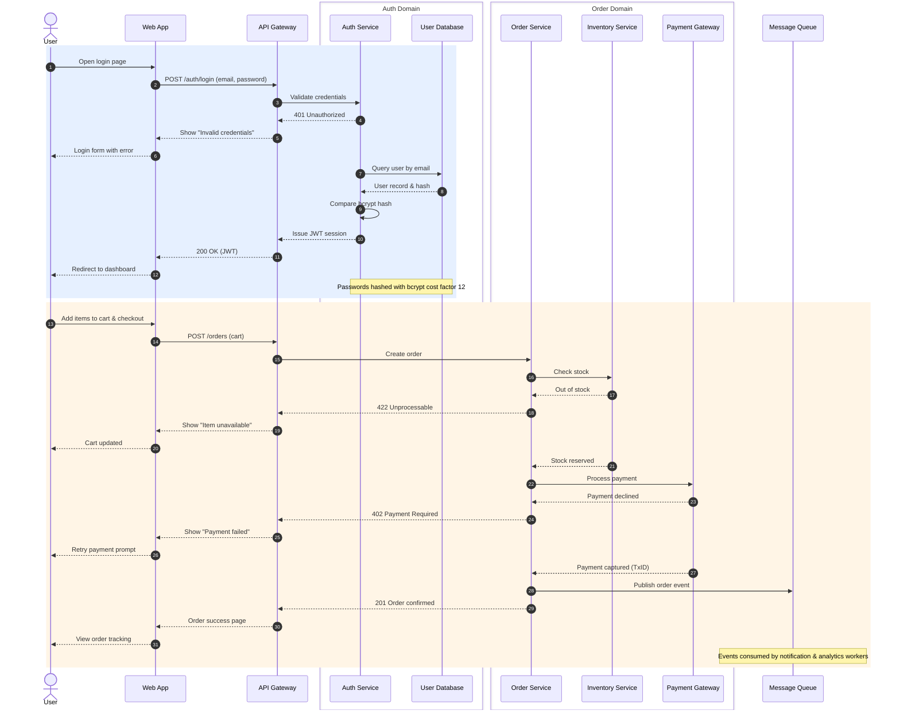

---

## Part 4 — Flowcharts: Architecture & Pipelines

Flowcharts model system topology, decision trees, and pipelines. Foliant
supports all Mermaid node shapes and edge types, plus **subgraphs** (which
auto-generate tags just like `box` in sequence diagrams), **regions**, and
full canvas editing.

### Node Shapes
Rectangle `[Box]`, rounded `(Box)`, circle `((Circle))`, database `[(DB)]`,
decision `{Diamond}`, asymmetric `>Flag]`.

### Edge Types
`-->` normal, `---` open, `==>` thick, `-.->` dotted, `<-->` bidirectional.

### Subgraphs
`subgraph Title` … `end` groups nodes visually and auto-generates a kebab-case
tag. The **By Key** filter can collapse a subgraph into a single node
(**Merged**), drop internal edges (**Clean**), or hide it entirely (**Off**).

### Try it
The diagram below is a **CI/CD pipeline** with subgraphs for each stage.
Click it to open in the editor, then:
1. **Drag a node** to reorder it along the flow axis.
2. **Hover a node** — four connect handles appear. Drag from one node's handle
   to another to create an edge.
3. **Click an edge** — the properties panel lets you change its label, type,
   color, width, and dash pattern.
4. In the **By Key** filter, set `build` to **Merged** — the Build subgraph
   collapses into a single node.
5. Toggle the **Orientation** button (TD ↔ LR) to flip the layout.

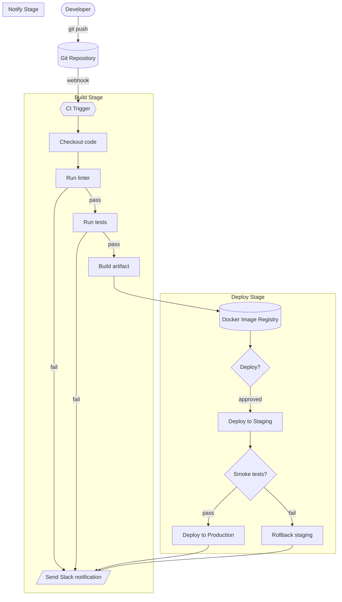

---

## Part 5 — Filtering & Layers: Tags, Regions & Merging

Foliant's filtering system lets you slice a large diagram into focused views
without editing the file.

### The Sidebar Filters
The left sidebar has three filter groups:

| Filter | What it does |
|---|---|
| **By Region** | Toggle `flow=…`, `edge-case=…`, and `note` regions on/off |
| **By Key** | Set domain tags to On / Merged / Clean / Off |
| **By Color** | Group participants by their accent color; merge or hide color groups |

### The 3-Tier Abstraction (By Key)
For any tag key (manual or auto-generated from `box`/`subgraph`):
- **On** — Full view: all participants, nodes, and messages visible.
- **Merged** — Collapse tagged participants into a single actor/node. Internal
  messages become self-calls.
- **Clean** — Like Merged, but internal self-calls are removed. Shows only
  boundary messages (the executive summary view).
- **Off** — Hide the tagged elements entirely.

### URL State
Every filter toggle syncs to the URL. Copy the URL and share it — the
recipient sees the exact same filtered view.

### Try it
The diagram below has participants tagged with `frontend`, `backend`,
`auth`, `storage`, and `payment`. It also has `box` groupings.

1. In **By Key**, set `auth` to **Merged** — Auth Service + User Database
   collapse into "Auth Domain".
2. Set `auth` to **Clean** — internal messages between them disappear.
3. Set `backend` to **Off** — all backend services vanish, leaving only the
   Client.
4. In **By Color**, merge participants that share a color.
5. Copy the URL — it encodes all your filter choices.

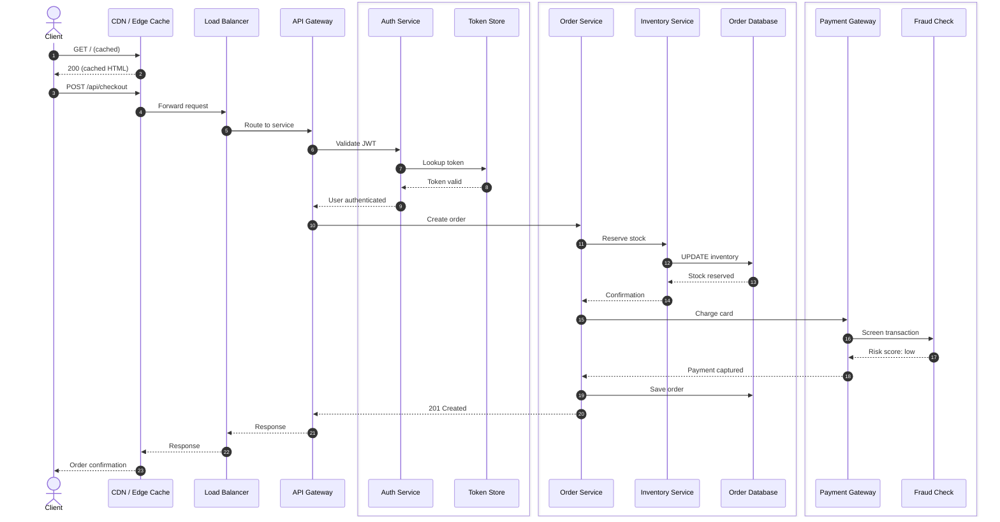

---

## Part 6 — Visual Editing: Create, Move, Retarget, Delete

Everything on the canvas is editable. Edits rewrite the source file as clean
Mermaid syntax. **Edit mode** is on by default.

### Creating Elements
- **Add Participant** (toolbar button): Adds a new actor at the right end.
- **Add Message** (toolbar button): Adds a message. With a message selected,
  the new one is inserted after it. With a participant selected, that
  participant is the sender.
- **Add Node / Add Edge** (flowchart toolbar): Same idea for flowcharts.
- **Add Sequence Note** (toolbar button): Creates a `Note over` element.

### Drag to Connect (Sequence)
- **Hover** over any participant's lifeline — a **connect handle** (a dot with
  a plus) appears just below the actor box.
- **Drag** from the handle to another participant's lifeline to create a
  message. A green slot indicator shows the insertion point.
- **Drag** from a handle back onto the **same** participant to create a
  self-call (e.g., `Auth->>Auth: Validate token format`).

### Drag to Connect (Flowchart)
- **Hover** a node — four connect handles appear at the edge midpoints.
- **Drag** from a handle to another node to create an edge.
- **Drag** a node body (not a handle) to move it along the layout axis.

### Moving & Reordering
- **Drag a participant box** left/right to reorder columns.
- **Drag a message** vertically up/down to change its chronological order.
- **Drag a flowchart node** to reorder it along the flow axis (TD or LR).

### Retargeting Endpoints
- **Click a message** to select it — origin and recipient handles appear.
- **Drag the arrowhead** (`to`) onto another participant to change the
  recipient.
- **Drag the tail** (`from`) onto another participant to change the sender.
- Styles and tags follow the retargeted message.

### Double-Click Inline Editing
- **Double-click** any participant box, flowchart node, or message/edge label
  to edit it in place. A floating input opens over the element.
- `Enter` or click-away commits; `Escape` cancels.

### The Properties Panel
Click any element to open the context-sensitive panel on the right:
- **Participants/Nodes:** Edit label, change type (participant/actor/database/
  queue), set color, assign tags, delete.
- **Messages/Edges:** Edit label, change operator type (`->`, `-->`, `->>`,
  `-->>`, `-x`, `--x`, `-)`, `--)`, `---`, `==>`, `-.->`, `<-->`), set
  color, width (1–10px), dash pattern (solid/dashed/dotted), toggle tag
  inheritance, delete.
- **Notes:** Edit text, change placement (`over`/`left of`/`right of`), change
  participant span, assign tags, delete.
- **Blocks** (`alt`/`opt`/`loop`/`par`/`rect`): Rename title, convert type,
  unwrap, delete.
- **Nothing selected:** Set the **global default arrow style** (fallback color
  and width for all arrows).

### Try it
Click this diagram to open it in the editor, then practice each action:

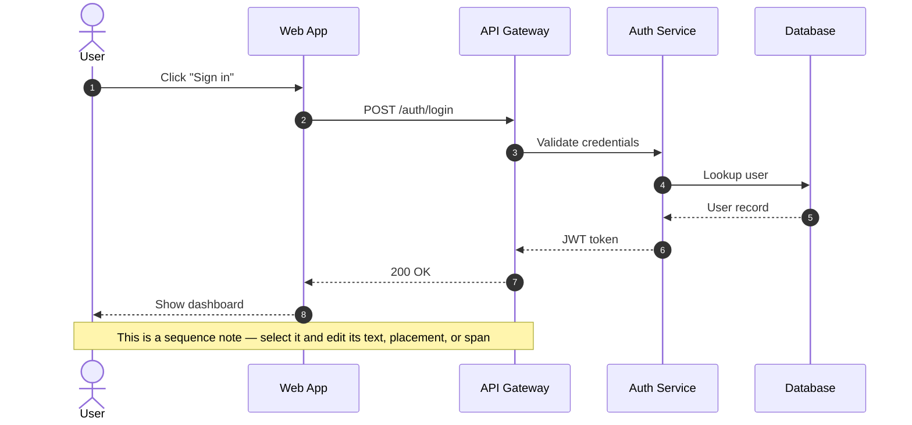

**Practice checklist:**
1. Hover over the **Auth Service** lifeline → drag from the connect handle to
   **Database** → a new message appears.
2. Click the new message → drag its arrowhead to **API Gateway** → retargeted.
3. Drag the **User** participant box to the right of **Database** → reordered.
4. Drag a message vertically → chronological order changes.
5. Double-click the **Auth Service** box → rename it → `Enter`.
6. Select a message → in the panel, change its color to `#00ff9d`, width to
   `3`, dash to `dashed`.
7. Click **Add Participant** → a new actor appears → rename it.
8. Press `Ctrl+Z` three times → undoes your last three edits.
9. Press `Ctrl+Y` → redoes them.

---

## Part 7 — Presenter Mode (Walkthrough)

Presenter mode steps through a diagram one message/edge at a time — perfect for
live demos, design reviews, and teaching. Future steps are dimmed; the active
step is highlighted with a personal box per involved element.

### How to Start
- Click the **Play** button (walkthrough icon) in the toolbar. A control bar
  appears at the bottom of the canvas.

### Controls
| Control | Action |
|---|---|
| **Skip Back** (←) | Go to previous step |
| **Play / Pause** (Space) | Auto-advance through steps |
| **Skip Forward** (→) | Go to next step |
| **Exit** (Esc) | Leave presenter mode |

### Works on Both Diagram Types
- **Sequence diagrams:** Steps through messages in chronological order.
  Notes and sticky notes associated with the active step are highlighted.
- **Flowcharts:** Steps through edges/paths level by level.

### Try it — Sequence Diagram
Click the diagram below, then click the **Play** (walkthrough) button in the
toolbar. Use arrow keys or the on-screen controls to step through the
authentication flow. Press `Space` to auto-play, `Esc` to exit.

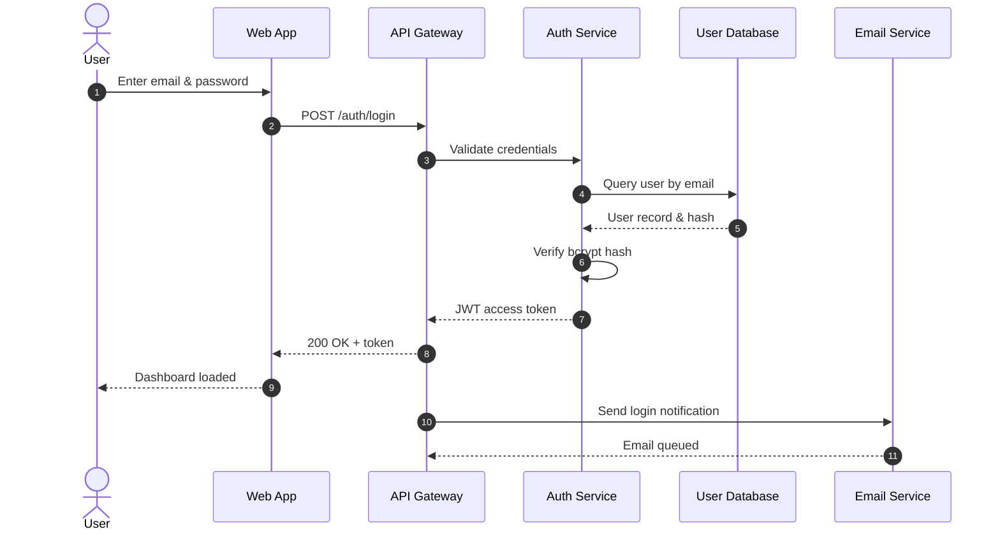

### Try it — Flowchart
Click this CI/CD flowchart, then start presenter mode. Each edge in the
pipeline becomes a step.

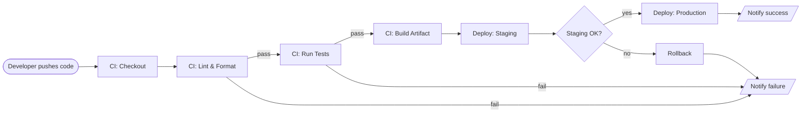

---

## Part 8 — Animated Arrows & Motion Presets

Bring diagrams to life with animated SVG motion paths. Arrows animate
sequentially in chronological order.

### 9 Motion Presets
| Preset | Code | Best for |
|---|---|---|
| Stream | `flow` | Standard async streams, event loops |
| Glowing Orb | `pulse` | High-energy packet transit |
| Cyber Glow | `cyber` | High-throughput RPCs |
| Broken Sender | `broken-sender` | HTTP 500, origin panic |
| Broken Network | `broken-network` | Network drops, timeouts, partitions |
| Broken Receiver | `broken-receiver` | 4xx/5xx rejection, target crash |
| Stutter | `stutter` | Jittery or congested links |
| Ricochet | `ricochet` | Immediate rejection, redirect |
| Hesitate | `hesitate` | High-latency, slow downstreams |

### How to Animate
1. Select a message on the canvas.
2. In the properties panel, pick an **animation** style.
3. Pick a **color** from the palette (5 positive hues + 5 error hues).
4. Or click **Convert Diagram** in the bottom motion bar to animate ALL arrows
   at once.

### Try it
This diagram already has animations. Click it to open in the editor, select a
message, and try different animation styles. Watch them play sequentially.

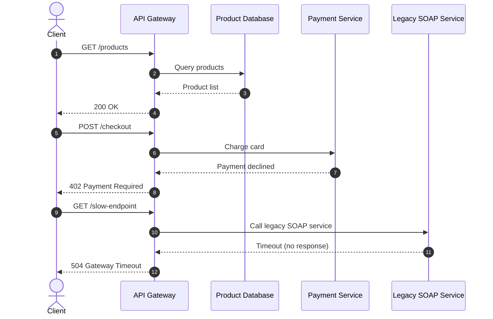

---

## Part 9 — Sticky Notes

Add draggable, resizable sticky notes to any diagram canvas. They are perfect
for architectural decisions, open questions, TODO items, and review feedback.

### Features
- **Drag** to reposition. **Resize** from the bottom-right corner.
- **6 pastel colors:** yellow, green, blue, pink, orange, purple.
- **Markdown support:** `**bold**`, `*italic*`, `` `code` ``, and **task
  checklists** (`- [ ]` / `- [x]`) with clickable checkboxes.
- **Taggable:** Assign domain tags — set a tag to **Off** in By Key to hide
  the note.
- **Shift+click** to multi-select notes alongside other elements.

### How to Add
Click the **Notes (N)** button in the toolbar to toggle the notes layer, then
click the **+** on the notes toolbar to add a new sticky note.

### Try it
Click the diagram below to open it in the editor. Click **Notes** in the
toolbar to show the notes layer. Add a new sticky note, drag it, resize it,
change its color, type some markdown with a checklist, and tag it.

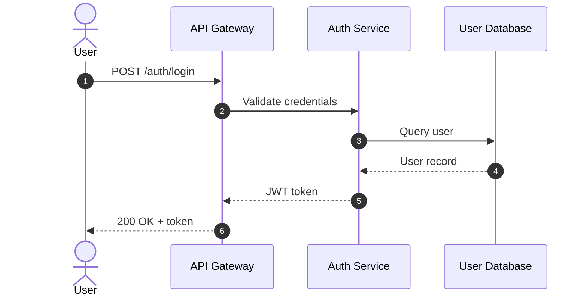

---

## Part 10 — Saved Views & Sharing

Saved views are named, persistent filter configurations stored in the diagram's
`%% CONFIG:` header.

### Creating a View
1. Set up your filters (hide edge cases, merge domains, etc.).
2. Click **Save View** in the sidebar.
3. Enter a name (e.g., "Happy Path", "Security Audit", "Backend Only").

### Switching Views
- Use the **View dropdown** in the sidebar.
- In markdown previews, use the per-block **View dropdown**.
- Views sync to the URL (`?view=Happy+Path`).

### Sharing
Copy the URL — it encodes the file, filters, view, search query, theme, and
diagram index. Send it to a teammate; they see the exact same perspective.

### Try it
The diagram below has two saved views. Try switching between them from the
sidebar View dropdown. Notice how each view hides different regions.

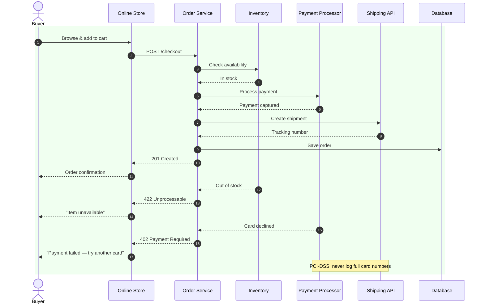

---

## Part 11 — Shift-Select, Multi-Element Operations & Deletion

### Shift-Select
Hold **Shift** and click multiple elements to multi-select them. The properties
panel switches to **"Selected Elements (N)"** mode, showing:
- **Tags by Element:** See which tags each selected element has.
- **Add tag to all:** Tag all selected elements at once.
- **Wrap in Block:** Wrap selected contiguous messages in an `alt`, `opt`,
  `loop`, `par`, or `rect` block.
- **Wrap in Region:** Wrap selected messages in a `%% @region-start: flow=…`
  region.
- **Group into Box:** Wrap selected participants into a `box` block.

### Deletion
- Select an element and press **Delete** / **Backspace**, or click **Delete**
  in the properties panel.
- Deleting a **participant** or **node** that has messages/edges triggers a
  **cascade confirmation** dialog listing everything that will be removed.
- Deleting a **message** or **edge** is immediate (no dialog).
- Deleting a **note** (sequence or sticky) shows a confirmation.
- **Undo** (`Ctrl+Z`) restores deleted elements.

### Keyboard Shortcuts
| Shortcut | Action |
|---|---|
| `Delete` / `Backspace` | Delete selected element(s) |
| `Escape` | Clear selection / cancel drag |
| `Ctrl+Z` / `Cmd+Z` | Undo |
| `Ctrl+Y` / `Cmd+Shift+Z` | Redo |
| `←` / `→` | Previous / next step (in presenter mode) |
| `Space` | Play / pause (in presenter mode) |
| `Esc` | Exit presenter mode |

### Try it
Click this diagram to open it in the editor. Practice:
1. **Shift+click** three messages → they are all selected.
2. In the panel, click **Add tag to all** → tag them `review-needed`.
3. With those messages still selected, click **Wrap in Loop** → they are
   wrapped in a `loop` block.
4. **Shift+click** two participants → click **Group into Box** → they are
   wrapped in a `box`.
5. Select a participant that has messages → press `Delete` → the cascade
   dialog appears → confirm → all messages are removed too.
6. Press `Ctrl+Z` → everything is restored.

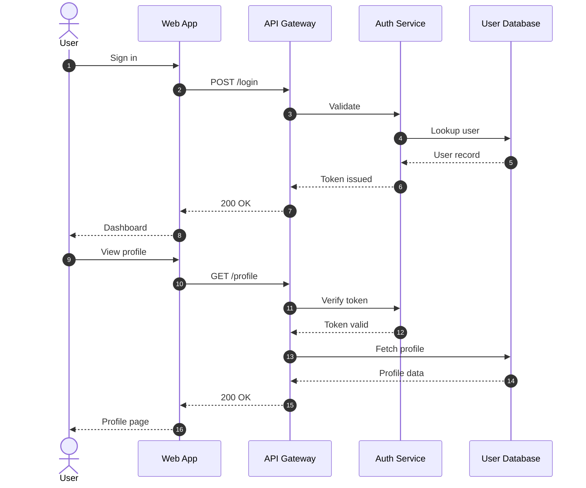

---

## Part 12 — Split View & Source Editing

For developers who want to see the code alongside the canvas:

### Split View
Toggle the **Split View** (columns icon) in the toolbar. A Monaco editor
appears next to the canvas with:
- Full syntax highlighting and line numbers.
- **Live line diffing:** When you make a visual edit on the canvas, the
  affected lines light up green in the editor for 5 seconds.
- Search and all VS Code-grade editing features.

### Edit Modes
- **Visual Mode:** Edit on the canvas. The source code updates automatically.
- **Code Mode:** Edit in Monaco. The canvas re-renders on valid syntax.
- The two modes are **mutually locked** — you cannot edit both simultaneously.

### Error Resilience
If you type invalid Mermaid syntax, the last valid diagram stays rendered on
screen with a syntax error alert. No crash, no data loss.

### Try it
Click any diagram to open it. Toggle **Split View**. Make a visual edit (e.g.,
rename a participant) and watch the corresponding line light up green in Monaco.
Then switch to **Code Mode** and edit the source directly.

---

## Part 13 — Creating New Diagrams & Files

### New Diagram Dialog
Click **New** in the Files header to create a new file:
- Choose a **name** (alphanumeric, hyphens, underscores).
- Choose a **type**: Sequence diagram, Flowchart, or Markdown document.
- The file is created in the current directory with starter content.

### File Types
| Type | Starter Content |
|---|---|
| Sequence diagram | Two participants and a message |
| Flowchart | Two nodes and an edge |
| Markdown document | A heading and a sample mermaid block |

### Try it
Click **New** in the Files header. Create a sequence diagram named
`my-first-diagram`. It opens with starter content. Edit it!

---

## Part 14 — Export & Productivity

### Export SVG
Click **Export SVG** in the toolbar to download a standalone SVG file:
- Full XML namespaces and standalone declaration.
- Preserves all custom colors, widths, dash patterns, and animations.
- Embeds sticky notes with markdown formatting.
- Ready for wikis, READMEs, presentations, and architecture reviews.

### Copy Mermaid Code
Click the **Copy** icon to copy the current diagram's Mermaid source to your
clipboard.

### One-Click Knobs
| Button | Action |
|---|---|
| **Autonumber** (list icon) | Toggle `autonumber` on/off in sequence diagrams |
| **Orientation** (arrows icon) | Toggle flowchart TD ↔ LR |
| **Copy** (copy icon) | Copy Mermaid source to clipboard |
| **Export SVG** (download icon) | Download standalone SVG |
| **Split View** (columns icon) | Toggle Monaco split view |
| **Edit** (pencil icon) | Toggle edit mode on/off |
| **Theme** (sun/moon icon) | Toggle dark/light theme |

### Auto-Save & Live Reload
- Every edit **auto-saves** to disk within 1 second.
- External edits (in your IDE) are detected and **hot-reloaded** automatically.
- The save indicator in the toolbar shows: **Saving…** → **Saved** (or
  **Save failed** on error).

---

## Part 15 — Putting It All Together: Architecture Diagram

This final diagram is a complete **e-commerce platform architecture** that
combines everything you have learned: regions, tags, boxes, subgraphs, arrow
styling, animations, notes, and saved views.

### Try it — The Full Workflow
1. **View:** Open this diagram. Toggle regions in the sidebar to focus on
   specific flows (browse, checkout, async processing).
2. **Filter:** Use By Key to merge the Auth Domain, Payment Domain, and
   Fulfillment Domain into single actors. Switch to Clean mode.
3. **Present:** Start presenter mode and walk through the checkout flow.
4. **Edit:** Click to open in the editor. Add a new participant (e.g.,
   "Recommendation Service"). Drag from its connect handle to the API Gateway
   to create a message. Style the message with an animation.
5. **Annotate:** Add a sticky note with a TODO checklist.
6. **Save a view:** Hide the async processing flow, save the view as "Sync
   Flow Only".
7. **Share:** Copy the URL and send it to a teammate.
8. **Export:** Export as SVG for your architecture review deck.

```mermaid
%% CONFIG: {"version":1,"actors":{"User":{"color":"#213b5e","keys":["frontend"]},"CDN":{"color":"#213b5e","keys":["frontend","edge"]},"Web":{"color":"#213b5e","keys":["frontend"]},"Mobile":{"color":"#213b5e","keys":["frontend"]},"LB":{"color":"#1a5557","keys":["backend","edge"]},"GW":{"color":"#1a5557","keys":["backend","gateway"]},"Auth":{"color":"#3d1d62","keys":["auth","security"]},"SessionDB":{"color":"#194821","keys":["storage","auth"]},"Catalog":{"color":"#194821","keys":["backend","catalog"]},"CatalogDB":{"color":"#194821","keys":["storage","catalog"]},"Cart":{"color":"#621d26","keys":["backend","cart"]},"CartDB":{"color":"#621d26","keys":["storage","cart"]},"Order":{"color":"#621d26","keys":["backend","orders"]},"OrderDB":{"color":"#194821","keys":["storage","orders"]},"Pay":{"color":"#584a1f","keys":["payment","external"]},"Fraud":{"color":"#584a1f","keys":["payment","security"]},"Inv":{"color":"#584a1f","keys":["inventory"]},"Ship":{"color":"#1a5557","keys":["fulfillment"]},"Notify":{"color":"#1a5557","keys":["notifications"]},"Analytics":{"color":"#3d1d62","keys":["analytics"]},"Search":{"color":"#194821","keys":["search"]}},"arrows":[{"from":"User","to":"CDN","label":"HTTPS request","color":"#00ff9d","animation":"pulse"},{"from":"CDN","to":"Web","label":"Serve SPA (cached)","color":"#00ff9d","animation":"flow"},{"from":"Web","to":"GW","label":"API call","color":"#00ff9d","animation":"flow"},{"from":"GW","to":"Auth","label":"Verify JWT","color":"#00f0ff","animation":"flow"},{"from":"Auth","to":"SessionDB","label":"Validate session","color":"#00f0ff","animation":"flow"},{"from":"GW","to":"Catalog","label":"GET /products","color":"#00ff9d","animation":"flow"},{"from":"Catalog","to":"CatalogDB","label":"Query catalog","color":"#00ff9d","animation":"flow"},{"from":"GW","to":"Cart","label":"Manage cart","color":"#00ff9d","animation":"flow"},{"from":"Cart","to":"CartDB","label":"Persist cart","color":"#00ff9d","animation":"flow"},{"from":"Web","to":"GW","label":"POST /checkout","color":"#00ff9d","animation":"pulse"},{"from":"GW","to":"Order","label":"Create order","color":"#00ff9d","animation":"flow"},{"from":"Order","to":"Inv","label":"Reserve stock","color":"#00ff9d","animation":"flow"},{"from":"Order","to":"Pay","label":"Process payment","color":"#4f8cff","animation":"pulse"},{"from":"Pay","to":"Fraud","label":"Fraud check","color":"#4f8cff","animation":"flow"},{"from":"Pay","to":"Order","label":"Payment result","color":"#00ff9d","animation":"flow"},{"from":"Order","to":"OrderDB","label":"Save order","color":"#00ff9d","animation":"flow"},{"from":"Order","to":"Ship","label":"Create shipment","color":"#00f0ff","animation":"cyber","dash":"dashed"},{"from":"Order","to":"Notify","label":"Send confirmation","color":"#00f0ff","animation":"cyber","dash":"dashed"},{"from":"Order","to":"Analytics","label":"Track purchase event","color":"#38ef7d","animation":"flow","dash":"dotted"},{"from":"Web","to":"GW","label":"GET /search?q=","color":"#00ff9d","animation":"flow"},{"from":"GW","to":"Search","label":"Full-text search","color":"#00ff9d","animation":"flow"}],"views":[{"name":"Happy Path — Checkout","hiddenPaths":["flow=browse/note","flow=async-processing","flow=search"]},{"name":"Async Processing Focus","hiddenPaths":["flow=browse","flow=checkout/note"]},{"name":"Edge Cases Only","hiddenPaths":["flow=browse/happy","flow=checkout/happy"]}],"noteTags":[{"over":["Web","GW"],"text":"CDN caches product catalog API responses (TTL: 60s)","keys":["caching","performance"]},{"over":["Pay","Fraud"],"text":"PCI-DSS Level 1 — card data never touches our servers","keys":["security","compliance"]},{"over":["Order","OrderDB"],"text":"Orders use sagas for distributed transaction consistency","keys":["reliability"]}]}
sequenceDiagram
    autonumber
    actor User
    participant CDN as CDN / Edge
    participant Web as Web App (React)
    participant Mobile as Mobile App
    participant LB as Load Balancer
    participant GW as API Gateway

    box #e2d0f8 Auth Domain
        participant Auth as Auth Service
        participant SessionDB as Session Store
    end

    box #cdeed3 Catalog & Search
        participant Catalog as Catalog Service
        participant CatalogDB as Catalog DB
        participant Search as Search Service
    end

    box #f8d0d6 Cart & Orders
        participant Cart as Cart Service
        participant CartDB as Cart DB
        participant Order as Order Service
        participant OrderDB as Order DB
    end

    box #f5ebc8 Payment & Inventory
        participant Pay as Payment Gateway
        participant Fraud as Fraud Check
        participant Inv as Inventory Service
    end

    box #c9f0f2 Fulfillment & Notifications
        participant Ship as Shipping API
        participant Notify as Notification Service
        participant Analytics as Analytics Pipeline
    end

    %% @region-start: flow=browse
    rect rgb(230, 242, 255)
        %% @region-start: happy
        User->>CDN: HTTPS request
        CDN-->>User: Cached static assets
        User->>Web: Open app
        CDN->>Web: Serve SPA (cached)
        Web->>GW: API call
        GW->>Auth: Verify JWT
        Auth->>SessionDB: Validate session
        SessionDB-->>Auth: Session valid
        Auth-->>GW: Authenticated

        GW->>Catalog: GET /products
        Catalog->>CatalogDB: Query catalog
        CatalogDB-->>Catalog: Product data
        Catalog-->>GW: Product list
        GW-->>Web: 200 OK

        Web->>GW: Manage cart
        GW->>Cart: Add/remove items
        Cart->>CartDB: Persist cart
        CartDB-->>Cart: Cart saved
        %% @region-end

        %% @region-start: note
        Note over Web,GW: CDN caches product catalog API responses (TTL: 60s)
        %% @region-end
    end
    %% @region-end

    %% @region-start: flow=checkout
    rect rgb(255, 248, 230)
        %% @region-start: happy
        User->>Web: Click "Checkout"
        Web->>GW: POST /checkout
        GW->>Order: Create order
        Order->>Inv: Reserve stock
        Inv-->>Order: Stock reserved
        Order->>Pay: Process payment
        Pay->>Fraud: Fraud check
        Fraud-->>Pay: Risk score: low
        Pay-->>Order: Payment captured
        Order->>OrderDB: Save order
        OrderDB-->>Order: Order saved
        %% @region-end

        %% @region-start: note
        Note over Pay,Fraud: PCI-DSS Level 1 — card data never touches our servers
        Note over Order,OrderDB: Orders use sagas for distributed transaction consistency
        %% @region-end
    end
    %% @region-end

    %% @region-start: flow=async-processing
    rect rgb(240, 255, 240)
        Order->>Ship: Create shipment
        Ship-->>Order: Tracking number
        Order->>Notify: Send confirmation
        Notify-->>Order: Email queued
        Order->>Analytics: Track purchase event
        Analytics-->>Order: Event recorded
    end
    %% @region-end

    %% @region-start: flow=search
    User->>Web: Type search query
    Web->>GW: GET /search?q=…
    GW->>Search: Full-text search
    Search-->>GW: Search results
    GW-->>Web: 200 OK
    Web-->>User: Display results
    %% @region-end
```

---

## Part 16 — Quick Reference Card

### Canvas Interactions
| Action | How |
|---|---|
| Pan | Drag canvas |
| Zoom | Mouse wheel / pinch / zoom pill |
| Fit to screen | Click "Fit" in zoom pill |
| Select element | Click it |
| Multi-select | Shift+click |
| Clear selection | Click empty canvas or `Escape` |
| Create message (seq) | Drag from lifeline connect handle to another lifeline |
| Create self-call (seq) | Drag from handle back to same lifeline |
| Create edge (flow) | Drag from node handle to another node |
| Move message (seq) | Drag message up/down |
| Reorder participant (seq) | Drag participant box left/right |
| Move node (flow) | Drag node body |
| Retarget message endpoint | Drag arrowhead or tail to another participant |
| Inline edit label | Double-click the label |
| Delete element | Select + `Delete` / `Backspace` |
| Undo | `Ctrl+Z` / `Cmd+Z` |
| Redo | `Ctrl+Y` / `Cmd+Shift+Z` |

### Markdown Preview
| Action | How |
|---|---|
| Edit prose | Click any paragraph/heading |
| Switch to code editor | Click **Edit** toggle |
| Toggle diagram tags | Click tag chips in diagram header |
| Switch diagram view | Use View dropdown in diagram header |
| Open diagram in editor | Click the diagram |

### Presenter Mode
| Action | How |
|---|---|
| Start | Click Play (walkthrough) button |
| Next step | `→` or Skip Forward |
| Previous step | `←` or Skip Back |
| Auto-play | `Space` |
| Exit | `Esc` or X button |

### Sidebar Filters
| Filter | Controls |
|---|---|
| By Region | Toggle flows, edge cases, notes on/off |
| By Key | On / Merged / Clean / Off per tag |
| By Color | Merge or hide color groups |

---

## Congratulations!

You have completed the tutorial. You now know how to:

- Navigate and search the canvas
- Read and edit Markdown documents with embedded diagrams
- Toggle tags and regions from both the sidebar and the markdown preview
- Create, move, retarget, and delete elements on the canvas
- Shift-select and perform multi-element operations
- Use presenter mode for both sequence diagrams and flowcharts
- Style and animate arrows
- Add sticky notes with markdown and checklists
- Save and share views via URL
- Use split view and source editing
- Export SVG and copy Mermaid code

**Next steps:** Create your own diagrams! Click **New** in the Files header,
or open any `.mmd` file and start editing. Happy diagramming!
